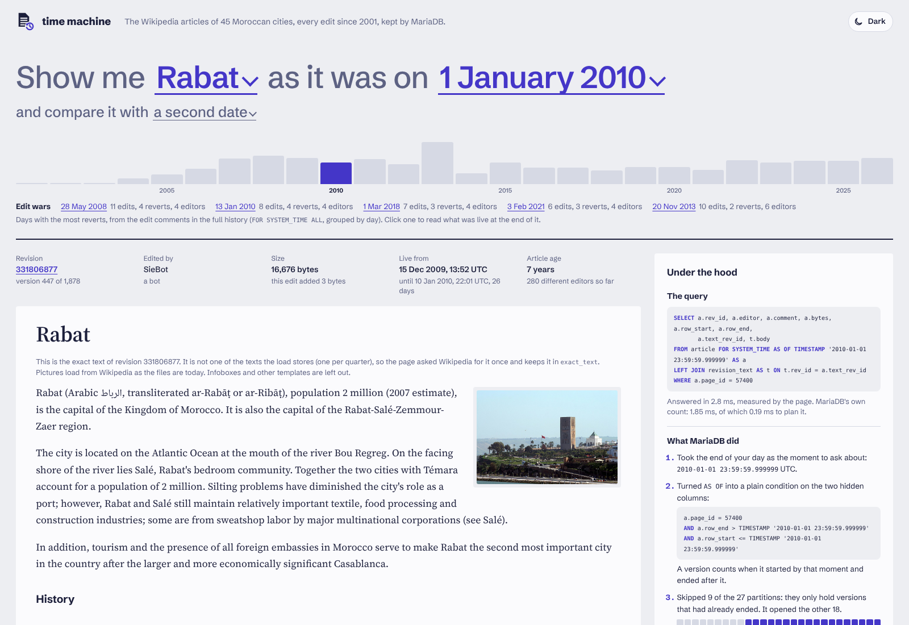
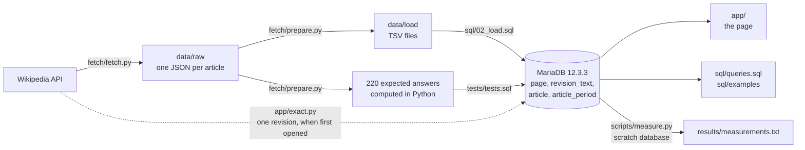
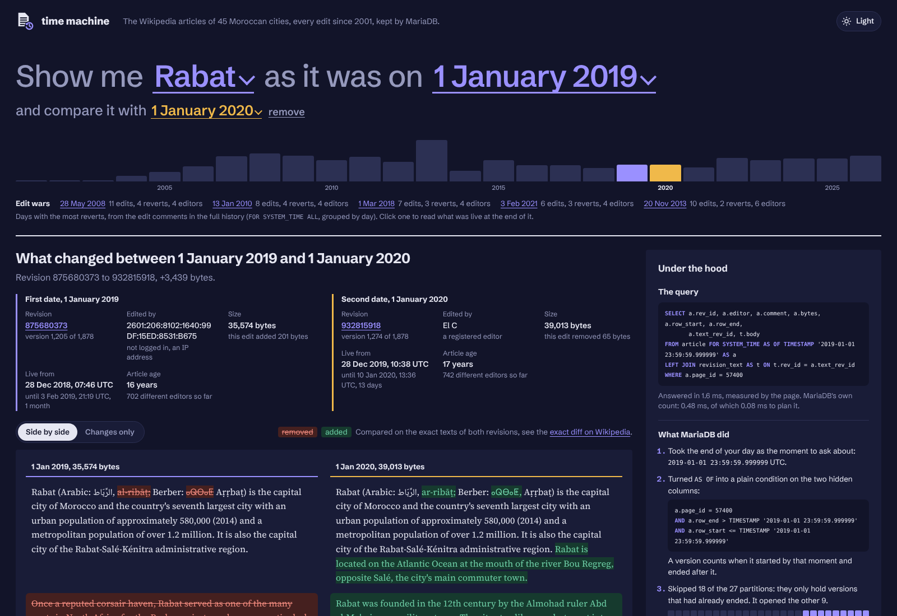
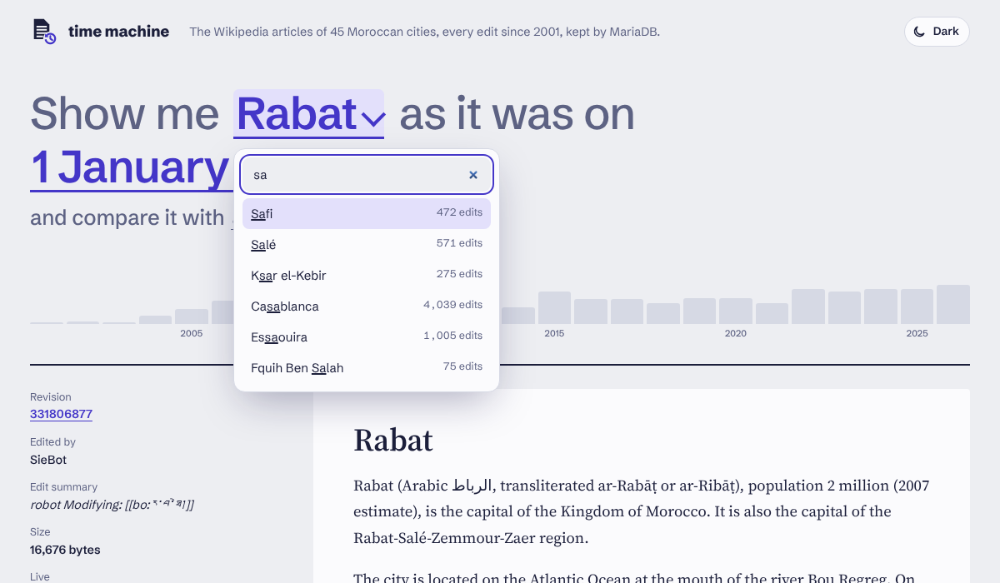
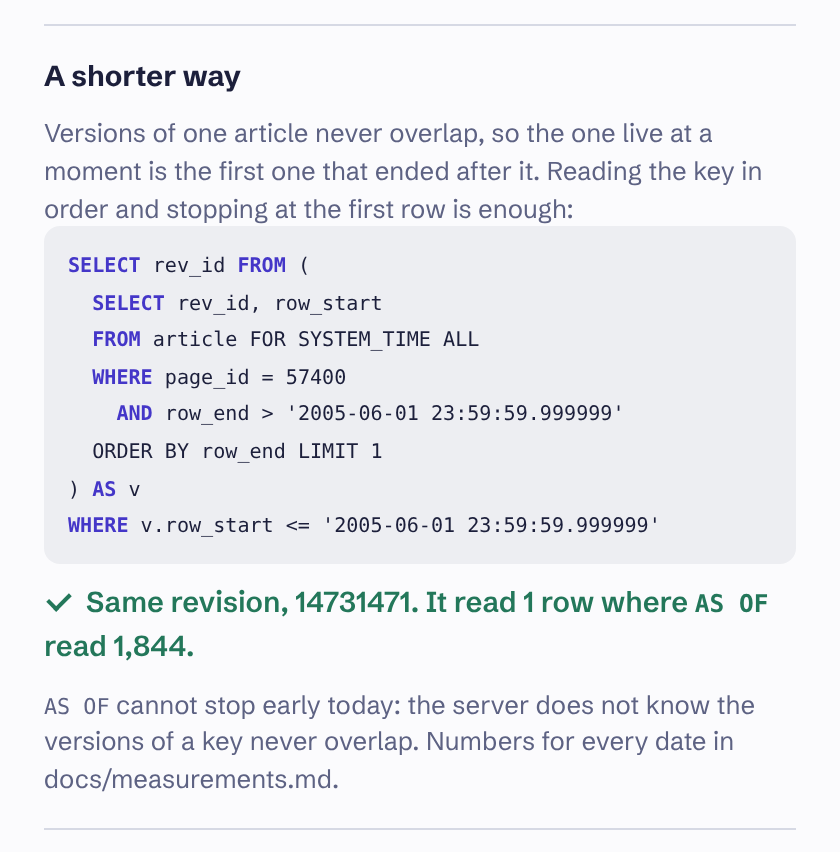

A project for area 3, "System-versioned tables: history for free" for the [MariaDB student database projects, 2026-09](https://mariadb.org/bachelor_hackathon_2026-09/).

<p align="center">
  <picture>
    <source media="(prefers-color-scheme: dark)" srcset="docs/logo/logo-dark.svg">
    
  </picture>
</p>

<h1 align="center">Wikipedia time machine on MariaDB</h1>

<p align="center">
  Pick a Moroccan city and a date, and read its Wikipedia article as it stood that day.<br>
  The history is kept by one table <code>WITH SYSTEM VERSIONING</code>: no revision table, no triggers, no application code.
</p>

<p align="center">
  <a href="https://github.com/ayoublabrinssi/Capstone-MariaDB-time-machine/actions/workflows/ci.yml"></a>
  
  
  
  
</p>

<p align="center">
  <a href="#quick-start">Quick start</a> ·
  <a href="#what-we-found">What we found</a> ·
  <a href="#how-time-is-modelled">How time is modelled</a> ·
  <a href="#the-page">The page</a> ·
  <a href="#the-old-date-problem">The old-date problem</a> ·
  <a href="#problems-found-and-what-we-did">Problems and fixes</a> ·
  <a href="#what-it-replaces">What it replaces</a>
</p>



## In short

- **Real history, real dates.** 31,179 revisions of 45 Moroccan city articles, from November 2001 to October 2026, loaded with Wikipedia's own edit times as `row_start` and `row_end`.
- **One clause answers "what did it say then?"** `FOR SYSTEM_TIME AS OF` picks the version; the page shows the exact text of that revision, compares two dates side by side, and explains how MariaDB found it.
- **Two clocks.** `article` keeps Wikipedia time as system time. `article_period` keeps it as application time that can be corrected, with system time on top: bitemporal.
- **Checked against the source.** 220 moments are worked out in Python from the raw API data and compared with what `AS OF` returns. All 40 database checks and 62 Python tests pass, and CI runs them on every push.
- **Measured.** Size, speed and what retention gives back, at 1x, 2x and 4x the data, against a plain table and against a classic revision table, three runs with the spread. See [docs/measurements.md](docs/measurements.md).
- **Taken to its weak spot.** An old date is where this design loses: `AS OF` 2005 reads 1,845 of Rabat's 1,878 versions to keep one. MariaDB explained why, and the project measures three ways around it. One reads a single row for any date. See [The old-date problem](#the-old-date-problem).
- **A minute to try.** Three articles come with the repository: `scripts/start.sh --data sample` needs no download.
- **Given back.** Seven findings for MariaDB, each explained in plain words with a file that reproduces it ([docs/findings](docs/findings/README.md)), and a tutorial on loading existing history ([docs/import-tutorial.md](docs/import-tutorial.md)).

> **Status (13 Nov 2026):** all seven steps of the [roadmap](#roadmap) are done. Left, outside this repository: filing the notes with MariaDB and the final presentation on 3 December.

## Why

Wikipedia runs on MariaDB and keeps its history in an application-level `revision` table, designed years before system versioning existed. This project loads the real edit history of 45 Moroccan city articles into a system-versioned table and answers "what did the article say on that date?" with one clause:

```sql
SELECT rev_id, editor, bytes
FROM article FOR SYSTEM_TIME AS OF TIMESTAMP '2005-01-01 00:00:00'
WHERE page_id = 57400;   -- Rabat
```

## What we found

Loading a past that already happened into a feature built to record from today forward took MariaDB 12.3.3 to its edges. These are the findings. Each one has its own page in [docs/findings](docs/findings/README.md), written for someone who has never used system versioning: the idea in plain words, a small example, what the server answered, what works around it, and the command to see it yourself.

| Finding | What happens | Where it stands |
|---|---|---|
| [A past date stops answering after an import](docs/findings/01-auto-partitions-lose-imported-history.md) | with `AUTO` partitions, imported history lands in one partition, and after the first live `UPDATE` an old date returns nothing | avoided here by making every yearly partition before the load; may be a bug |
| [Setting the clock back loses a version](docs/findings/02-clock-set-back-loses-a-version.md) | an `UPDATE` stamped before the current version started is accepted; that version disappears and some dates get two answers | the load never moves the clock; may be a bug |
| [An old date reads almost the whole history](docs/findings/03-old-dates-read-the-whole-history.md) | `AS OF` 2005 reads 1,845 of Rabat's 1,878 versions to return one | a query that stops at the first match reads 1; idea for the optimizer |
| [`OPTIMIZE TABLE` fails but says it worked](docs/findings/04-optimize-says-it-worked.md) | after `DELETE HISTORY` the rebuild is refused inside the result rows, and the statement succeeds | retention uses `DROP PARTITION`; may be a bug |
| [Anyone who can write can write the past](docs/findings/05-anyone-can-write-the-past.md) | a user with only `INSERT` and `UPDATE` adds a version dated 2015 or 2030 | load first, then lock with `secure_timestamp=YES`; documentation |
| [Imported versions can overlap](docs/findings/06-imported-versions-can-overlap.md) | two versions of one key may cover the same months; `AS OF` then returns two rows | check 21 tests every article; documentation |
| [Smaller things](docs/findings/07-smaller-things.md) | the 1970 floor, a confusing `WITHOUT OVERLAPS` error, backups without history, and two more | documentation |

To click through them instead, open [docs/findings/explorer.html](docs/findings/explorer.html) in a browser: the same findings as figures you can step through and drag. None of them is filed with MariaDB yet; [docs/contributions.md](docs/contributions.md) says where each one goes.

## Quick start

Requirements: Docker with Compose (tested with Colima on an Intel Mac) and Python 3.8 or newer.

```sh
git clone https://github.com/ayoublabrinssi/Capstone-MariaDB-time-machine.git
cd Capstone-MariaDB-time-machine
scripts/start.sh --data sample   # a first look: three articles, no download, about a minute
scripts/start.sh --data fixed    # everything: all 45 articles, about 15 minutes of download the first time
```

Either one checks the tools, makes `.env` with random passwords, starts MariaDB 12.3.3, loads the data, runs the 40 database checks and 62 Python tests, and starts the page on http://127.0.0.1:8000. Run it again any time: the steps already done are skipped. Without `--data` it asks which data to use. `scripts/start.sh --help` lists the options.

### Which data

`start.sh` asks first, before anything else. `--data sample`, `--data fixed` or `--data newest` answers without asking.

| | Sample | Fixed date (default) | Newest |
|---|---|---|---|
| Articles | Rabat, Ifrane and Asilah, in [data/sample/](data/sample) | all 45 | all 45 |
| Edits | up to 26 Oct 2026, 2,600 revisions | up to 26 Oct 2026, 31,179 revisions; the last one of each article is in [data/snapshot.tsv](data/snapshot.tsv) | every edit up to the day you run it |
| Download | none | about 15 minutes, 131 MB | about 15 minutes |
| Use it to | see the page and the tests run | compare with the results and the numbers in this README | see the articles as they are today |
| Same numbers as `results/` and this README | for Rabat, yes | yes | no |
| Tests | pass | pass | pass |

The sample is cut from the fixed date data, so everything this README says about Rabat holds on it. The walk-through queries run on it too. Only what is about another city needs the full data: the Casablanca part of query 13 and the Marrakesh correction example.

The tests, the files in `results/` and every number in this README were made on the fixed date data. With the newest data, these change:

- more revisions and history rows, and a newer latest version of each article;
- `AS OF` an old date reads more rows, because more versions ended after it;
- the 2026 partition and any later ones hold more rows;
- the 220 test moments are drawn from the new data, so they are other moments;
- the timings in `docs/measurements.md` will not match exactly.

The tests compare MariaDB with the loaded data itself, so they pass with all three. If Wikipedia has hidden a revision since 26 October 2026, the fixed date download says so and has one revision less.

### By hand

The same steps one by one:

```sh
cp .env.example .env          # set the two passwords
docker compose up --wait      # MariaDB 12.3.3, database timemachine
scripts/fetch.sh --snapshot data/snapshot.tsv   # fixed date, 26 Oct 2026 (about 15 min); without the option: newest
scripts/install.sh            # build the tables and load them (a few seconds); --sample loads data/sample/ instead
scripts/test.sh               # 40 database checks and 62 Python tests
scripts/run.sh                # the page, on http://127.0.0.1:8000
```

The page needs one package, PyMySQL, which goes into `.venv` on first start.

### Stop and clean up

```sh
# Ctrl+C in the terminal stops the page
docker compose down           # stops MariaDB and keeps the loaded data
docker compose down -v        # stops it and removes the database
scripts/measure.sh --clean    # drops the scratch database of the measurements, if you ran them
rm -rf .venv .env data/raw data/load   # everything else the scripts made in this folder
```

## The data

| | |
|---|---|
| Articles | 45 Moroccan cities, listed in [data/articles.txt](data/articles.txt) |
| Revisions | 31,179, from 11 Nov 2001 to 26 Oct 2026 |
| Stored text | 3,330 revisions at load: the first of every quarter and the latest of each article. Any other revision: fetched once, when first opened |
| Source | MediaWiki API, fetched 26 Oct 2026 by [fetch/fetch.py](fetch/fetch.py); the exact end of each article is in [data/snapshot.tsv](data/snapshot.tsv) |
| In the repository | [data/sample/](data/sample): Rabat, Ifrane and Asilah, 2,600 revisions, 2 MB gzipped |

The download is not committed (131 MB). `scripts/fetch.sh` repeats it and skips articles already on disk. [fetch/prepare.py](fetch/prepare.py) turns the JSON into tab-separated files for `LOAD DATA`.

Every revision is stored with its editor, comment and size. The wikitext of all 31,179 revisions is 1.2 GB, so the load stores one text per article per quarter, 65 MB. The page fills the gap one revision at a time: the first time a revision is opened it asks Wikipedia for that text and keeps it in the table `exact_text`, so the article on screen is the exact revision. Offline, or with `EXACT_TEXT=off` in `.env`, it shows the closest stored text at or before the revision and says so.

## How time is modelled

System versioning stamps a row with the moment the `INSERT` ran. A naive import would record the history of the loading script, not of the article. The area description gives three ways out:

| Option | What it means | Used here |
|---|---|---|
| Import-time stamps | replay the edits in order, accept that every row starts at load time | no: the dates would be meaningless |
| `system_versioning_insert_history` | write `row_start` and `row_end` yourself, once, with the real edit times | **yes**, table `article` |
| Application-time period | keep the edit times as ordinary columns with `PERIOD FOR` | **yes**, table `article_period`, next to system time |

**Why both.** Only system time gets `FOR SYSTEM_TIME AS OF`, partitioning by `SYSTEM_TIME` and `DELETE HISTORY`. So the time machine itself is `article`, with Wikipedia's own timestamps written in at import. But system time is append-only: once loaded, it can never be corrected. Real data needs corrections. `article_period` holds the same periods as ordinary data that can be updated with `FOR PORTION OF`, while its system time records when the database learned each fact. That makes it bitemporal: it answers "what was true then" and "what did we believe then".

[sql/examples/wikipedia_correction.sql](sql/examples/wikipedia_correction.sql) shows this on a real case: an edit to Marrakesh that was live for 19 hours in April 2018 before it was reverted.

```
| question                   | rev_id    |
| live on Wikipedia          | 838361314 |
| our service today          | 838361178 |
| our service before the fix | 838361314 |
```

## Data model

| Table | Kind | Rows | Holds |
|---|---|---|---|
| `page` | plain | 45 | one row per article |
| `revision_text` | plain, never changes | 3,330 | the wikitext stored by the load, one per article per quarter |
| `exact_text` | plain, a cache | grows with use | the wikitext of any other revision, fetched by the page when first opened |
| `article` | system-versioned, partitioned by year | 45 current, 31,179 in all | one version per revision, `row_start` / `row_end` = real edit times |
| `article_period` | bitemporal | 31,179 | `valid_from` / `valid_to` = edit times, `WITHOUT OVERLAPS` |

The text sits in its own table the way Wikipedia splits revisions from text. The schema is in [sql/01_schema.sql](sql/01_schema.sql), the load in [sql/02_load.sql](sql/02_load.sql).

`article` is partitioned by `SYSTEM_TIME` with one partition per year, 2001 to 2026, plus `pn` for current rows. A history row lives in the partition of the year its version **ended**.

Why it looks like this:

- **`article` has `page_id` alone as its primary key.** One current row per article is the natural shape. Versioning adds `row_end` to the key by itself, so the history needs no index of its own. That choice is also the cause of the [old-date problem](#the-old-date-problem).
- **`row_start` and `row_end` are declared, and `INVISIBLE`.** Declared, because imported history has to write them. Invisible, so `SELECT *` still returns an article and not its bookkeeping.
- **The text is not in the versioned row.** It is large and never changes once written, so it sits in `revision_text` and a version row stays small. The other design was built and measured for Rabat ([results/text_cost.txt](results/text_cost.txt)): with the text inside each version row the table is 80 MB instead of 5 MB, and `AS OF` 2005 touches 4,870 disk pages instead of 31, because it reads the text of every version it passes. A version points at its text with `text_rev_id`; check 5 of the tests makes sure every pointer lands.
- **One partition per year,** because the year is the unit of forgetting: "keep the last N years" is one `DROP PARTITION`. The partitions are not there for speed, and the measurements say so.
- **`article_period` uses `DATETIME(6)`, not `TIMESTAMP`.** Application time is data: it should not move with the session time zone, and it can hold dates before 1970, which system time cannot. Its key `(page_id, valid_time WITHOUT OVERLAPS)` is the guarantee system time does not give for imported rows.
- **The page has its own user.** `timemachine_page` may `SELECT` in the database and `INSERT` into `exact_text`, nothing else. Check 38 reads its grants, and a page test tries `UPDATE` and `DELETE HISTORY` as that user and expects error 1142.
- **Everything is UTC.** Every script and every page connection sets `time_zone = '+00:00'`, because an `AS OF` literal is read in the session time zone.

## How it is built



- **Fetch.** `fetch/fetch.py` asks the MediaWiki API for every revision of each article and writes one JSON file per article. It can stop and continue, and with `--snapshot` it stops at a fixed revision per article so two people get the same data.
- **Prepare.** `fetch/prepare.py` turns the JSON into tab-separated files. Here a revision becomes a version: its end is the time of the next revision of the same article. The same script picks 220 moments and works out, without MariaDB, which revision was live at each. Those answers are what the tests compare against.
- **Load.** `sql/02_load.sql` is five `LOAD DATA` statements. The history goes in with `system_versioning_insert_history = 1`, the current rows with a start time only.
- **Page.** `app/` is five small files on the Python standard library plus PyMySQL: `server.py` takes a request and returns a page, `db.py` holds the SQL and asks MariaDB, `exact.py` gets the exact text of a revision, `views.py` writes the HTML, `wikitext.py` cleans wikitext and makes the diff. The SQL is a handful of constants at the top of `db.py` and every value goes to the server as a parameter. The page connects as a user that may only read, on a session set to read only.
- **Measure.** `scripts/measure.py` builds copies of `article` in a scratch database, so the numbers can be redone on any machine without touching the loaded data.

## Query walk-through

[sql/queries.sql](sql/queries.sql) has thirteen commented queries, output in [results/queries.txt](results/queries.txt):

1. the current articles, read like any table
2. `AS OF`: Rabat on 1 January 2005
3. `AS OF` on all 45 articles at three dates (Fez grew from 3,795 to 197,500 bytes)
4. `BETWEEN`: every version of Rabat live in the week of 13 January 2020 (three edits by one visitor in a minute, undone four hours later), and `FROM ... TO`, which leaves out the last instant
5. `ALL`: edits per year on Rabat
6. the shortest-lived versions (usually reverted vandalism)
7. the most active editors
8. one article at two dates: Rabat in 2010 and in 2020
9. the partitions and what pruning does
10. the same question through the application-time period, and that table's second clock: when the database learned each row
11. time travel for a whole session with `SET @@system_versioning_asof`, no `AS OF` in the query
12. edit wars: the days with the most reverts, from the edit comments in `FOR SYSTEM_TIME ALL`
13. the answer of query 2 from one row instead of nearly all of them: the first-row query, with `ANALYZE` for both, on Rabat and on Casablanca, the longest history here

## The page

`scripts/run.sh` starts a small page on http://127.0.0.1:8000. The question is one sentence: show me a city as it was on a date. The city list can be searched (accents are ignored, so "sale" finds Salé), and the date opens a calendar with its own month and year menus. The page shows the article as it stood at the end of that day: the text of that exact revision, with a link to it on Wikipedia. Add a second date to compare: side by side, the old version on the left and the new one on the right, or as changes only. Removed text is red, added text is green, and a rewritten paragraph sits next to its new version. Pictures and simple tables are shown too: pictures sit on the right with the text wrapping around them, as on Wikipedia, and galleries are a grid, so the compare also tells when one was added or removed. A switch in the top corner changes between light and dark; without a choice the page follows the system.

Each article view is one query, shown under the article with its parameters filled in:

```sql
SELECT a.rev_id, a.editor, a.comment, a.bytes, a.row_start, a.row_end,
       a.text_rev_id, t.body
FROM article FOR SYSTEM_TIME AS OF TIMESTAMP '2010-01-01 23:59:59.999999' AS a
LEFT JOIN revision_text AS t ON t.rev_id = a.text_rev_id
WHERE a.page_id = 57400
```

The bars above the article are edits per year from `FOR SYSTEM_TIME ALL`; a click on a year jumps to 1 July of that year. Under them, "Edit wars" lists the days when the article was reverted at least twice, found by grouping the history by day and counting the comments that say revert; a click opens that day. A row above the article gives the facts about the version on show: revision and its number among all versions, the editor (person, IP address or bot), the size and what this edit changed, when it went live and for how long, the age of the article and how many people had edited it by then. When two dates are compared, each gets its own row.

Next to the article, an "Under the hood" panel shows how MariaDB answered:

| Part | What it shows | Where it comes from |
|---|---|---|
| The query | the `AS OF` query with its parameters, the time the page measured, and MariaDB's own time | the page, `ANALYZE` |
| What MariaDB did | the answer step by step: the moment asked about, `AS OF` rewritten as a condition on `row_start` and `row_end`, the partitions skipped and read (as many as the server has now), the rows and disk pages read through the key, the one row kept, the text fetched | `ANALYZE FORMAT=JSON`, `information_schema.PARTITIONS` |
| Query plan | rows guessed before running next to rows read after | `EXPLAIN PARTITIONS`, `ANALYZE` |
| A shorter way | the first-row query for the same moment, the revision it gives and the rows it read next to the rows `AS OF` read | `FOR SYSTEM_TIME ALL ... ORDER BY row_end LIMIT 1`, `ANALYZE` |
| This row in system time | the invisible `row_start` and `row_end`, to the microsecond | the same query |
| Before and after | the previous and next versions, with links, and the number of edits that day | `FOR SYSTEM_TIME ALL` and `BETWEEN` |
| Cross-check | the revision the bitemporal table `article_period` gives for the same moment, and the revision a session set to that moment with `system_versioning_asof` gives, with the partitions it opened | application time, session time travel |
| What is stored | rows and size of each table, current and history rows, the server version | `information_schema` |

The step-by-step view makes one thing plain: for 1 January 2010, the date in the screenshot, MariaDB reads 1,432 of Rabat's rows to keep one, because the key starts at `row_end` and every version that ended after that date is a candidate. Right under it the panel asks the same thing the shorter way and reads 1 row. More on this in [The old-date problem](#the-old-date-problem).

<p align="center">
  
  
</p>

The code is in [app/](app): [server.py](app/server.py) (Python standard library `http.server`), [db.py](app/db.py) (PyMySQL), [exact.py](app/exact.py), [views.py](app/views.py), [wikitext.py](app/wikitext.py), and [app.js](app/app.js) for the city list and the calendar, in plain JavaScript with no framework. Without JavaScript the page falls back to the browser's own select and date inputs. The fonts come from Google Fonts; offline, the page uses system fonts. Limits, said plainly:

- **The exact text needs Wikipedia once per revision.** The revision, editor, size and dates come from the database and are always exact. The text is exact too when the revision is one of the 3,330 stored ones, or once the page has fetched it: one request to Wikipedia the first time, kept in `exact_text` after that. Without a connection the page shows the stored copy at or before that revision and says which one; when two dates then fall back to the same copy, it links to Wikipedia's own diff instead of showing an empty one. A revision whose text Wikipedia has hidden stays on the stored copy.
- **The wikitext cleaner is not a MediaWiki parser.** It keeps the names in other languages (`{{lang-ar|...}}` becomes "Arabic: ...") and converted numbers, drops other templates and references, and keeps links as plain words. Infoboxes, climate boxes and some inline values (like a name in Arabic inside a template) are lost; only the infobox photo is kept. Tables keep their rows and cells, without row or column spans.
- **Pictures are today's files.** The database stores the file name only, and the page loads the picture from Wikipedia, so a file that was changed since shows its new version, and a deleted one is hidden. This needs an internet connection.
- **It is read-only and local.** It listens on 127.0.0.1 only. It connects as `timemachine_page`, which has no right to change anything but the cache of exact texts, on a session set to `READ ONLY` and `time_zone = '+00:00'`, the time zone the edit times were loaded in. An error shows a plain page; the reason goes to the terminal, not to the browser.

## Same idea in a fleet app

[sql/examples/fleet.sql](sql/examples/fleet.sql) applies the same model to vehicle tracking. It is based on JPTrack, a fleet tracking platform in Morocco, with invented data. A driver assignment is corrected after the fact with `UPDATE ... FOR PORTION OF`, the table answers "who drove TRK-12 on 12 March" today and before the correction, and `WITHOUT OVERLAPS` refuses a second driver on the same truck (error 1062). Output in [results/fleet.txt](results/fleet.txt).

## Forgetting history

System versioning keeps everything. [sql/examples/retention.sql](sql/examples/retention.sql) shows the two ways to forget, on a copy of `article`, and prints the size of the copy after each step. Output in [results/retention.txt](results/retention.txt):

- `ALTER TABLE ... DROP PARTITION p0, p1, p2` drops whole years at once and gives the space back at once. Only the oldest partitions can go (error 4116 otherwise), so the rule is "keep the last N years".
- `DELETE HISTORY FROM ... BEFORE SYSTEM_TIME '2010-01-01'` removes the versions that ended before a date. The rows go, the space does not: the table has to be rebuilt, and `OPTIMIZE TABLE` on a versioned table only works with `system_versioning_alter_history = KEEP`.

After either, `AS OF` 2005 returns nothing for every article: the time machine is cut at the date chosen.

## Measurements

[docs/measurements.md](docs/measurements.md) has the numbers, made by `scripts/measure.sh` on a 2017 Intel Mac (Colima, 2 CPU, 4 GB): three runs of the script, each timing the median of 5 passes. In short:

| | |
|---|---|
| Size | 114 bytes of row per version, 3.6 MB for the 31,179. On disk it is that divided by how full the pages are: 7.3 MB as loaded (pages 48 % full), 4.5 MB after a rebuild ([results/growth.txt](results/growth.txt)). No index besides the primary key; a classic revision table needs one, 1.6 MB here |
| How it grows | one row per edit. Each partition also holds up to 1 MB of empty room once it passes 32 pages, which is why the size the server reports moves in steps |
| Text inside the versioned row instead | 80 MB for Rabat alone instead of 5 MB, and an old date reads 4,870 disk pages instead of 31 ([results/text_cost.txt](results/text_cost.txt)) |
| One article, one date | about 2 ms or less on every design: 1.9 ms with partitions, 1.6 ms without, 1.5 ms on a classic revision table. Partitions never help here and cost a little; on the laptop the three brackets overlap |
| All 45 articles, one date | 18 ms for 2005, 2 ms for 2026: pruning works for recent dates |
| 4x the data | one article's query does not get slower; the all-article query grows linearly |
| One key with a long history | `AS OF` 10% into 100,000 versions reads 90,001 rows in 61 ms; the first-row query reads 1 row in 1.5 ms |
| Retention | `DROP PARTITION` 14 ms and the space is back; `DELETE HISTORY` 30 ms and nothing is freed until a rebuild (0.4 s) |

The partitions stay even though they do not speed up the single-article question: they are what makes retention cheap.

## The old-date problem

This is the one place where the design loses on its own terms, so it got the most work.

**What happens.** `AS OF` an old date reads almost the whole history of the article to return one row.

| Rabat as of | Rows `AS OF` reads | Rows the first-row query reads |
|---|---|---|
| 2005-06-01 | 1,845 | 1 |
| 2010-06-01 | 1,385 | 1 |
| 2026-06-01 | 60 | 1 |

**Why.** The primary key of a versioned table is `(page_id, row_end)`. `AS OF T` takes every version that ended after `T` and then keeps the one that had started. Ask about 2005 and nearly every version ended after it.

**What MariaDB said.** I asked this when I presented the project to MariaDB on 5 November 2026, together with a second question: why did keeping the real dates need my own columns and a session switch? Their answer covered both. System versioning is designed to start recording on the day it is switched on and go forward from there. Loading a past that already happened is the exception, not the case it was built for. The measurements agree with that reading: a table that only records forward is mostly asked about recent moments, and for those the same key reads 60 rows and two partitions.

**Three ways around it, measured.**

| Way | Rabat, 2005 | Verdict |
|---|---|---|
| A second index on `(page_id, row_start)` | 34 index entries | Helps old dates only. It reads what started before the date, the primary key reads what ended after it, and in the middle of a long history both read half. It costs 1.6 MB on 5.8 MB of data and needs `system_versioning_alter_history = KEEP`. On a key with a million versions and an early date the optimizer ignores it and scans the table. Not adopted. |
| The application-time table `article_period` | 1,845 rows | No gain: its key ends in the period end too. |
| The first-row query | 1 row | Adopted. No index, no schema change. |

```sql
SELECT rev_id, editor, bytes
FROM (SELECT rev_id, editor, bytes, row_start
      FROM article FOR SYSTEM_TIME ALL
      WHERE page_id = 57400 AND row_end > '2005-06-01 00:00:00'
      ORDER BY row_end LIMIT 1) AS v
WHERE v.row_start <= '2005-06-01 00:00:00';
```

Versions of one article never overlap, so the one live at a moment is the first one that ended after it. The inner query walks the key in order and stops at that row; the outer `WHERE` drops it when the article did not exist yet.

<p align="center"></p>

The row counts in this README are for midnight at the start of the day, the moment the measurements ask about. The page asks about the end of the day, so for 1 June 2005 it shows 1,844 where the table above says 1,845.

**How much it matters.** On this data, little. Rabat has 1,878 versions and the longest history, Casablanca, has 4,039, of which `AS OF` 1 January 2005 reads 3,975 (query 13). Inside the server Rabat's old date goes from 2.0 ms to 0.08 ms, while the round trip from the page is about 1.4 ms either way. On a longer history it is the difference between usable and not:

| Versions of one key | `AS OF`, 10% into the history | First-row query |
|---|---|---|
| 10,000 | 9,001 rows, 7 ms | 1 row, 1.5 ms |
| 100,000 | 90,001 rows, 61 ms | 1 row, 1.5 ms |
| 1,000,000 | full scan, 658 ms | 1 row, 1.6 ms |

**What we did with it.**

- The page asks both ways on every view and shows the rows each read ("A shorter way" in the panel). Query 13 does the same in SQL.
- Check 22 of the tests runs the first-row query on all 220 moments and expects the revision Python computed. Check 21 makes sure no two versions of an article overlap, because the shortcut is only correct then, and the server does not check that for imported history.
- [docs/findings/03](docs/findings/03-old-dates-read-the-whole-history.md) asks MariaDB whether the optimizer could use this plan itself when the primary key is fully given.

## Tests

`scripts/test.sh` runs three sets.

[tests/tests.sql](tests/tests.sql) has 40 database checks. The main one: [fetch/prepare.py](fetch/prepare.py) picks 220 moments and computes in Python, from the raw JSON, which revision was live at each. The test runs every moment through `FOR SYSTEM_TIME AS OF` with parameters and expects the same revision, then does it again with the first-row query. It also checks that the application-time table agrees, that the versions of an article form one line with no overlap and no gap, that a session set with `system_versioning_asof` gives the same answer and comes back to `DEFAULT`, that `DELETE HISTORY` keeps the right rows, that only the oldest partition can be dropped, and that the server refuses what it should and accepts what it should not, from a date in 1969 to `TRUNCATE` to a clock set back. Checks 35 and 36 make one `UPDATE` on `article` today, see the server close the imported row itself, and roll it back. Check 38 reads the grants of the page's user. Check 39 pins what happens when the yearly partitions are missing at import (a past date loses its answer), and check 40 makes sure the loaded table is not in that state. Output in [results/tests.txt](results/tests.txt).

[tests/test_app.py](tests/test_app.py) has 46 tests for the page: the wikitext cleaner (with pictures, tables and names in Arabic and Berber), the diff and the side-by-side view, the date input (including an injection attempt), where the text of a version comes from (with a stand-in for Wikipedia: fetched once, kept, offline, hidden, switched off), the error page (the reason must not reach the browser), and the page against the database, including that the period table, the session time travel and the first-row query agree with `AS OF`, that the page's user is refused every write, and that two dates in one quarter are compared on their exact texts. The database ones are skipped, not failed, when MariaDB is not running.

[tests/test_fetch.py](tests/test_fetch.py) has 16 tests for the download and the preparation, on small made-up histories with no network and no database: which revisions get their text, when a file on disk is kept, and that each version ends where the next begins and points at the right text.

[.github/workflows/ci.yml](.github/workflows/ci.yml) runs two jobs on every push. The quick one lints the shell scripts, then does what a stranger would on the sample: `scripts/start.sh --data sample` from a fresh clone, every check and test, the examples that run on it, the trust check, and the growth and text-cost measurements. The full one does the same on all 45 articles at the fixed date, then the queries, the remaining examples, the backup check, the measurements and one request to the page. The Wikipedia download is cached between runs.

## Problems found, and what we did

Everything below was hit while building this, on 12.3.3. "Docs" says whether the [System-Versioned Tables](https://mariadb.com/docs/server/reference/sql-structure/temporal-tables/system-versioned-tables) page mentions it (read on 13 November 2026). Each row runs in the file named.

| Problem | What happens | What we did | Docs | File |
|---|---|---|---|---|
| Writing `row_start` is refused | error 1906 | the loader sets `system_versioning_insert_history = 1` for its session | one line | `sql/02_load.sql` |
| `AUTO` makes no partitions for imported history | all of it lands in one partition. After the first live `UPDATE`, `AUTO` adds the missing years and `AS OF` skips the old versions: a past date returns nothing, with no error | a partition for every year made before the load (`STARTS '2001-01-01' ... PARTITIONS 27`, more if loaded after 2026); check 40 guards it. `REPAIR TABLE` moves misplaced rows | no | `sql/examples/limits.sql`, step 9 |
| An old date reads most of the history | 1,858 rows for one (Rabat, 1 January 2005) | the first-row query: 1 row | no | `sql/queries.sql`, query 13 |
| Pruning helps recent dates only | `AS OF` 2005 opens 23 of 27 partitions, 2026 opens 2 | kept the partitions for retention, and say so | no | query 9 |
| Imported versions may overlap | both are stored, `AS OF` returns two rows for one key | a test that the loaded history has no overlap and no gap | no | `sql/examples/limits.sql`, check 21 |
| System time cannot be corrected | a wrong date stays wrong | a second, bitemporal table for what may need fixing | by design | `sql/examples/wikipedia_correction.sql` |
| History cannot start before 1970 | error 1292 | not hit by this data (2001 on); documented for others | no | `sql/examples/limits.sql` |
| `ALTER TABLE` is refused on a versioned table | error 4119, includes adding an index | schema settled before the load; `KEEP` used where a change is measured | yes | check 13 |
| `DELETE HISTORY` frees no space | 7,432 versions go and the table is as large as before | `DROP PARTITION` is the retention rule; a rebuild is measured | no | `sql/examples/retention.sql` prints the size after each step |
| `OPTIMIZE TABLE` fails quietly | the refusal comes back as result rows, the statement succeeds | shown with both outputs; written up | no | `sql/examples/retention.sql` |
| Only the oldest partitions can be dropped | error 4116 for `p10` while `p0` exists | the rule is "keep the last N years" | partly | check 20 |
| The `WITHOUT OVERLAPS` error is hard to read | `Duplicate entry 'TRK-12-2026-03-25-2026-03-20'`: the period end comes first | explained next to the example; written up | no | `sql/examples/fleet.sql` |
| A plain `mariadb-dump` leaves the history out | 45 rows restored out of 31,179, no warning | a script that dumps with `--dump-history`, restores and compares | yes | `scripts/backup_check.sh` |
| Each statement in a transaction gets its own time | `AS OF` can land on a value that was never committed alone | shown; tables versioned by transaction id avoid it but cannot be imported into or partitioned | partly | `sql/examples/limits.sql` |
| An `AS OF` literal is read in the session time zone | the same text means two moments in two sessions | every script and the page set UTC | no | `sql/examples/limits.sql` |
| Any user who can write can write a past | a user with only `INSERT` and `UPDATE` adds a version dated 2015 and one dated 2030; only `DELETE HISTORY` has its own privilege | the page's user can only read; a second server with `secure_timestamp=YES` refuses both (error 1290), and then refuses the import too | one line | `scripts/trust_check.sh` |
| One step back with the session clock loses a version | accepted with no error; the current version vanishes and the new one overlaps older ones | the load uses the switch, not a replay; a check pins the behaviour; written up | no | `sql/examples/limits.sql`, step 8 |
| The size the server reports does not follow the rows | 148, 216 and 273 bytes per version for the same rows at 1x, 2x and 4x | read the pages instead: 114 bytes of row per version in every table; the rest is how full the pages are and 1 MB steps per partition | no | `scripts/growth.sh` |
| The article text does not fit in the versioned row | 80 MB for one article, and an old date reads the text of every version it passes | text in its own table, one per quarter at load, the exact one fetched on demand | no | `scripts/text_cost.sh` |

[sql/examples/limits.sql](sql/examples/limits.sql) asks the server each of the edge questions in turn and prints its answer, output in [results/limits.txt](results/limits.txt). The ones worth sending back to MariaDB are explained one by one in [docs/findings](docs/findings/README.md), and [docs/contributions.md](docs/contributions.md) lists where each one goes. None is filed yet.

## Loading your own history

The part of this project most likely to be reused is the import. [docs/import-tutorial.md](docs/import-tutorial.md) is the recipe in five steps with a table of the limits above, and [sql/examples/import_history.sql](sql/examples/import_history.sql) runs it on six invented rows (the price of tea, sugar and mint since 2019) in a second. Copy it, change the table, keep the check in step 5. The tutorial also covers the other way in, replaying the changes with `SET @@timestamp`, and how to lock the history once it is loaded.

## Where it loses

Said plainly, from what this project ran into:

- **System time cannot be corrected.** Once a row is in history it stays as it is. A wrong edit time needs the application-time table next to it, which is why `article_period` exists.
- **Old dates cost more.** The key starts at `row_end`, so `AS OF` 2005 reads 1,845 of Rabat's rows to keep one, while `AS OF` 2026 reads 60. Partitions help recent questions, not old ones. The first-row query fixes it for one article at a time, not for a question over all articles.
- **Partitions do not help one article.** Measured: 1.9 ms per query with 27 partitions, 1.6 ms without, because an old date opens most partitions anyway. A classic revision table with an index on edit time reads one row and takes 1.5 ms.
- **Importing history is a special case.** It needs `system_versioning_insert_history`, and the yearly partitions must exist before the load. `AUTO` does not make them for imported rows, and a table loaded without them gives wrong answers after its first live write ([limits.sql](sql/examples/limits.sql), step 9).
- **The schema is hard to change later.** `ALTER TABLE` is refused on a versioned table by default.
- **History only grows.** Nothing is removed until someone runs `DELETE HISTORY` or drops a partition, and `DELETE HISTORY` gives no space back until the table is rebuilt. Rows that arrive in time order also leave the pages of a partitioned table half empty: 7.3 MB on disk for 3.6 MB of rows here.
- **History is only as safe as the accounts that can write.** The server does not check imported history for overlaps, and on a default server any user who can write to the table can also write a past or a future: the import switch and the session clock need no special right. [scripts/trust_check.sh](scripts/trust_check.sh) shows it, and shows the lock: a server started with `secure_timestamp=YES` refuses both, for root too. The same lock refuses the import, so the order is load first, lock after. Output in [results/trust.txt](results/trust.txt).
- **Big values do not belong in the versioned row.** Every version carries a full copy, and `AS OF` reads the copies of all the versions it passes. Measured for Rabat in [results/text_cost.txt](results/text_cost.txt).

## What it replaces

Wikipedia runs on MariaDB and keeps its history in a `revision` table that its own code fills, designed years before system versioning existed. This project is the same history kept by the server instead. Side by side:

| Need | The application-level way | With system versioning |
|---|---|---|
| Keep every version | the application inserts a row per change, and must never forget to | the server does it on every `UPDATE` and `DELETE` |
| Read the past | a query on the revision table, written per table | `FOR SYSTEM_TIME AS OF`, or one `SET` for the whole session |
| Compare two dates | two lookups and a diff in the application | two `AS OF` reads; the diff is still the application's job |
| Forget old history | batch deletes | `DROP PARTITION` for a year, or `DELETE HISTORY` |
| Correct a past fact and keep what was believed before | a second audit table | application time next to system time: bitemporal |
| Back up | an ordinary dump | `mariadb-dump --dump-history`, or the history is lost |
| Load history that already exists | plain rows | a switch, partitions made first, and your own checks |
| An old date on a long history | an index on the time: 1 row | every later version, unless the query is written to stop at the first |
| A date before 1970 | any `DATETIME` | not in system time |
| Stop anyone rewriting the past | rights on the revision table | `secure_timestamp=YES` and the `DELETE HISTORY` privilege; the default leaves it open |

The first six rows are why to use it: less code, and a history nobody can skip by forgetting a line. The last four are where Wikipedia's own design is still the better fit for Wikipedia: its history is the product, it was all loaded from somewhere, and people ask about 2005. System versioning is at its best where history is a by-product that has to be right: who drove which truck, what the price was when the order came in, what the record said before someone changed it.

## Roadmap

The plan runs six weeks, from 26 October to the final presentation on 3 December 2026. Each step is a [GitHub issue](https://github.com/ayoublabrinssi/Capstone-MariaDB-time-machine/issues).

| Step | What | Issue | State |
|---|---|---|---|
| 1 | Fetch the revision history of 45 articles | [#1](https://github.com/ayoublabrinssi/Capstone-MariaDB-time-machine/issues/1) | done |
| 2 | Schema with two clocks: system time and application time | [#2](https://github.com/ayoublabrinssi/Capstone-MariaDB-time-machine/issues/2) | done |
| 3 | Load the revisions with their real dates, queries, tests | [#3](https://github.com/ayoublabrinssi/Capstone-MariaDB-time-machine/issues/3) | done |
| 4 | The page: pick a city and a date, compare two dates | [#4](https://github.com/ayoublabrinssi/Capstone-MariaDB-time-machine/issues/4) | done |
| 5 | Fleet example: who drove which truck, as we knew it then | [#6](https://github.com/ayoublabrinssi/Capstone-MariaDB-time-machine/issues/6) | done |
| 6 | Measure how the table grows and what partitioning does | [#5](https://github.com/ayoublabrinssi/Capstone-MariaDB-time-machine/issues/5) | done |
| 7 | The old-date problem, limits, tutorial, notes for MariaDB, CI, evaluation run and what it found | [#7](https://github.com/ayoublabrinssi/Capstone-MariaDB-time-machine/issues/7) | done |

Step 6 answered its four questions in [docs/measurements.md](docs/measurements.md): size at 1x, 2x and 4x, `AS OF` with and without partitions, what retention gives back, and the same question on a classic revision table. Step 7 took the answer MariaDB gave on 5 November and followed it: the old-date problem measured and worked around, the edges of system time tested one by one, the import written up as a tutorial, and the notes for MariaDB collected in [docs/contributions.md](docs/contributions.md). A run of MariaDB's evaluation prompt on the result then pointed at what was still thin, and that became the last round: the exact text of every revision, a sample that needs no download, a user for the page that can only read, and the trust and text-cost checks. The code was finished on 13 November, two weeks before the target of 27 November.

## Project structure

```
compose.yaml          MariaDB 12.3.3 in Docker, passwords from .env
scripts/              start.sh (all in one), fetch.sh, install.sh, page_user.sh, test.sh, run.sh, db.sh,
                      measure.sh and measure.py, growth.sh and growth.py, text_cost.sh and text_cost.py,
                      backup_check.sh, trust_check.sh
fetch/                fetch.py (Wikipedia API), prepare.py (JSON to TSV, expected answers)
sql/                  01_schema.sql, 02_load.sql, queries.sql (13 queries)
sql/examples/         wikipedia_correction, fleet, retention, limits, import_history, live_edit
tests/                tests.sql (40 database checks), test_app.py (46 page tests), test_fetch.py (16 tests)
results/              output of the queries, examples, tests, checks and three measurement runs
data/                 articles.txt, snapshot.tsv, sample/ (three articles); raw/ and load/ are not committed
app/                  the time machine page: server.py, db.py, exact.py, views.py, wikitext.py,
                      app.js, style.css, logo.svg
docs/                 findings/ (one page per finding, explorer.html), measurements.md,
                      import-tutorial.md, contributions.md, AI-log.md,
                      SELF-ASSESSMENT.md, screenshots/, logo/
.github/workflows/    ci.yml: lint, tests and a full run from a fresh clone
```

## Team

Ayoub Labrinssi, Constructor University Bremen, MSc Computer Science and Software Engineering. Supervisor: Dr. Joaquin Aguado. Partner: MariaDB Foundation.

AI use is recorded in [docs/AI-log.md](docs/AI-log.md).

## License

Code under MIT, see [LICENSE](LICENSE). Wikipedia text is CC BY-SA 4.0 and belongs to its authors. That includes the three articles in [data/sample/](data/sample), which carry the name of the editor of every revision.
