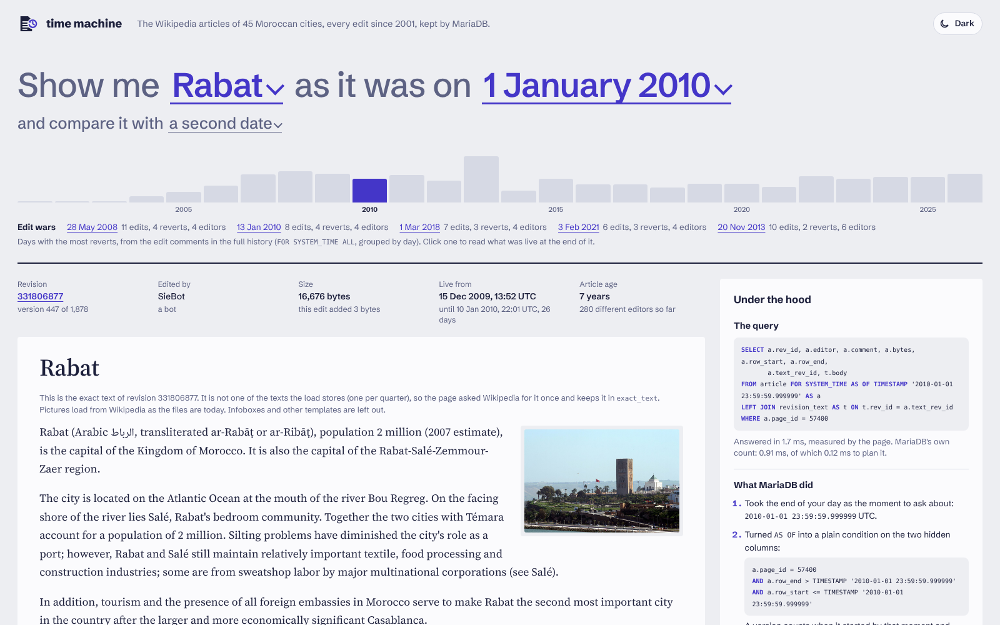
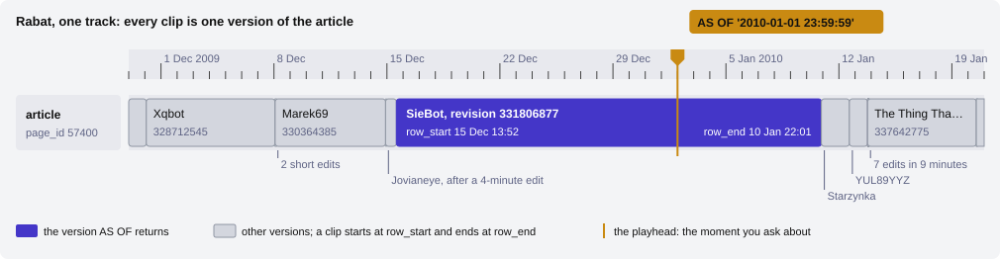
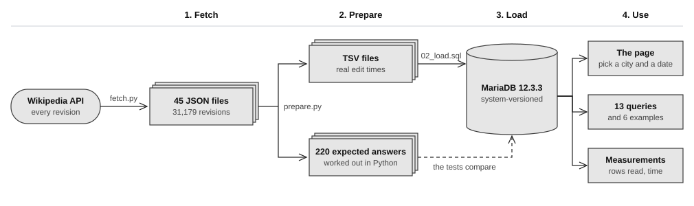
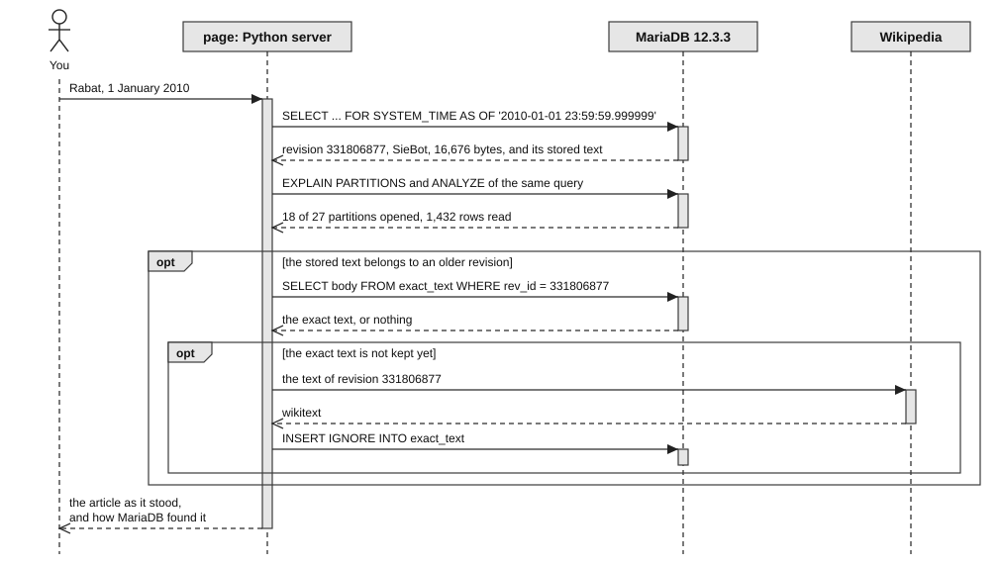
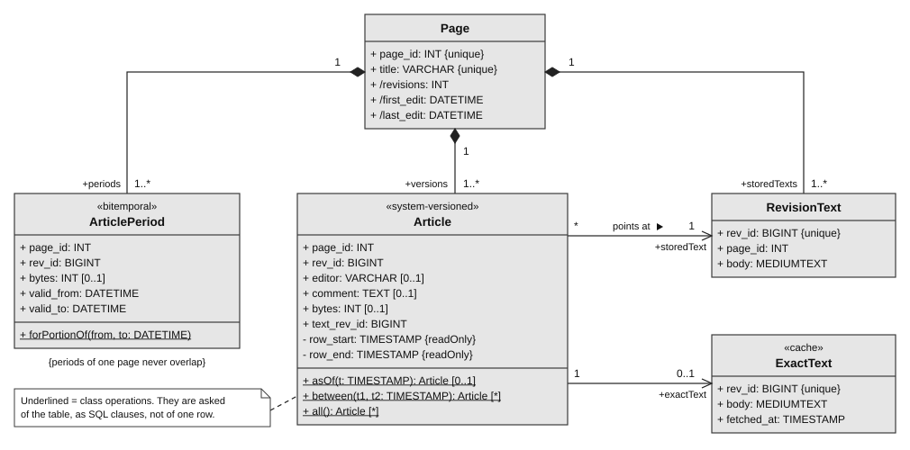
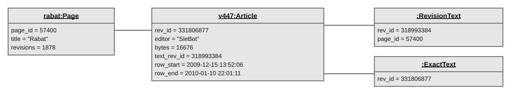
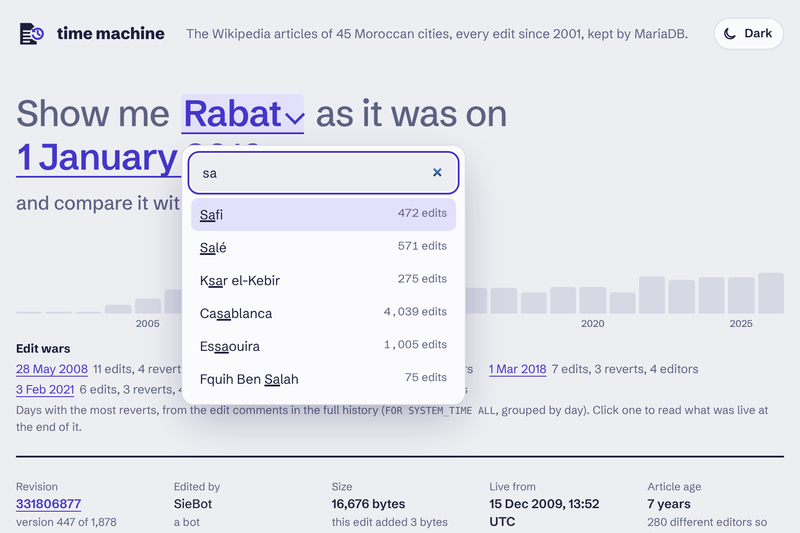
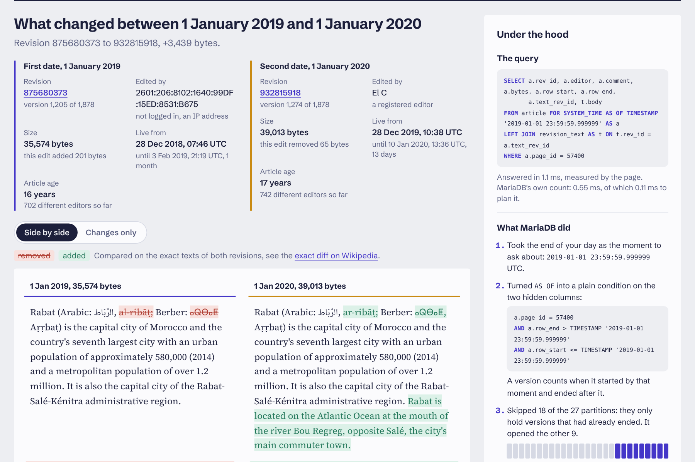
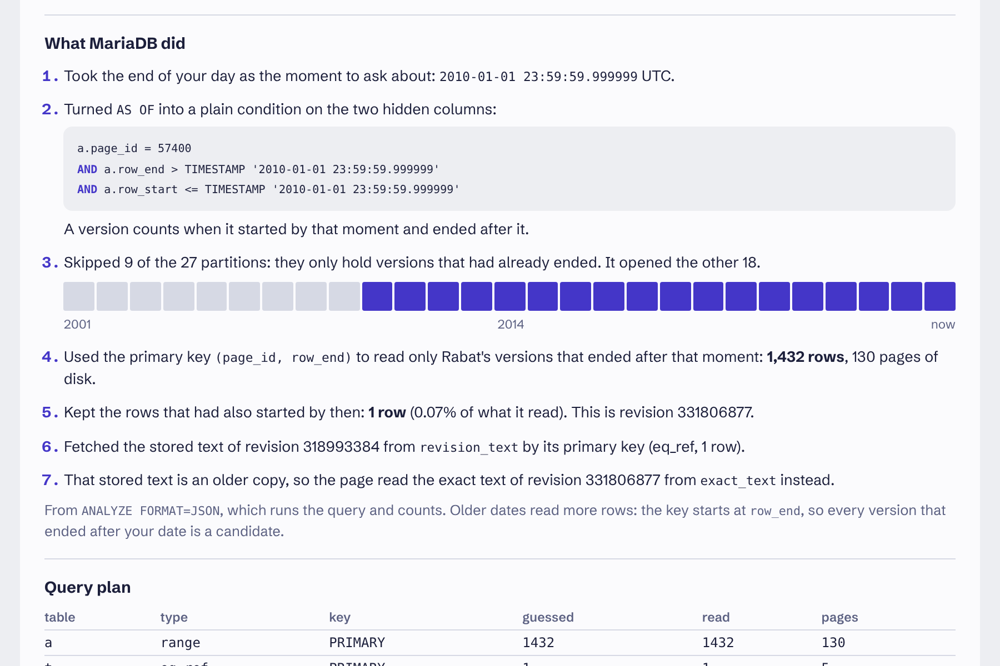
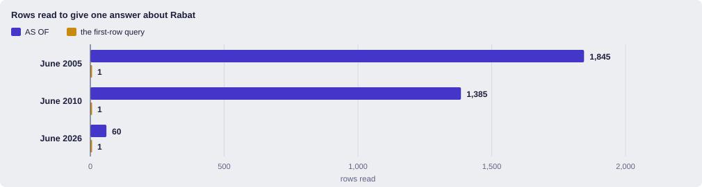

A project for area 3, "System-versioned tables: history for free" for the [MariaDB student database projects, 2026-09](https://mariadb.org/bachelor_hackathon_2026-09/).

<p align="center">
  <picture>
    <source media="(prefers-color-scheme: dark)" srcset="design/logo/logo-dark.svg">
    
  </picture>
</p>

<h1 align="center">Wikipedia time machine on MariaDB</h1>

<p align="center">
  Pick a Moroccan city and a date, and read its Wikipedia article as it stood that day.<br>
  The history is kept by one table <code>WITH SYSTEM VERSIONING</code>: no revision table, no triggers, no application code.
</p>

<p align="center">
  <a href="https://github.com/ayoublabrinssi/Capstone-MariaDB-time-machine/actions/workflows/ci.yml"></a>
  
  
  
  
</p>

<p align="center">
  <a href="#quick-start">Quick start</a> ·
  <a href="#how-it-works">How it works</a> ·
  <a href="#data-model">Data model</a> ·
  <a href="#what-we-found">What we found</a> ·
  <a href="#numbers">Numbers</a> ·
  <a href="docs/details.md">All the details</a>
</p>

<picture>
  <source media="(prefers-color-scheme: dark)" srcset="design/screenshots/day-dark.png">
  
</picture>

## The idea

Wikipedia runs on MariaDB and keeps every edit of every article in a revision table that its own code fills. This project loads the full edit history of 45 Moroccan city articles ([the list](data/articles.txt)) into a table where MariaDB keeps the history itself:

```sql
CREATE TABLE article (
  page_id     INT          NOT NULL PRIMARY KEY,
  rev_id      BIGINT       NOT NULL,
  editor      VARCHAR(255),
  comment     TEXT,
  bytes       INT,
  text_rev_id BIGINT       NOT NULL COMMENT 'stored text shown for this revision, see revision_text',
  row_start   TIMESTAMP(6) AS ROW START INVISIBLE,
  row_end     TIMESTAMP(6) AS ROW END INVISIBLE,
  PERIOD FOR SYSTEM_TIME (row_start, row_end)
) WITH SYSTEM VERSIONING
  PARTITION BY SYSTEM_TIME INTERVAL 1 YEAR STARTS '2001-01-01 00:00:00' AUTO PARTITIONS 27;
```

The version dates are Wikipedia's own edit times, written into `row_start` and `row_end` at import. After that, "what did the article say on that day?" is one clause:

```sql
SELECT rev_id, editor, bytes
FROM article FOR SYSTEM_TIME AS OF TIMESTAMP '2010-01-01 23:59:59'
WHERE page_id = 57400;   -- Rabat
```

<p align="center">
<picture>
  <source media="(prefers-color-scheme: dark)" srcset="design/charts/timeline-dark.svg">
  
</picture>
</p>

Read it like the timeline of a video editor. Each clip is one version of Rabat: it starts when the edit was saved (`row_start`) and ends when the next edit replaced it (`row_end`). The thin slices are edits that lived a few minutes. `AS OF` is the playhead: it returns the clip under it. Here that is revision 331806877, saved by SieBot on 15 December 2009 and replaced on 10 January 2010. The clips are the real versions from the table.

## At a glance

| What | In short |
|---|---|
|  **Real history** | 45 articles, 31,179 revisions, November 2001 to October 2026, each with its real edit time |
|  **One clause** | `FOR SYSTEM_TIME AS OF` picks the version. The page shows the exact text of that revision and compares two dates |
|  **Two clocks** | system time for the time machine, application time next to it for corrections: bitemporal |
|  **Checked** | 220 moments worked out in Python and compared with MariaDB. 40 database checks and 62 Python tests, run by CI on every push |
|  **Measured** | size, speed and cleanup at 1x, 2x and 4x the data, against a plain table and a classic revision table |
|  **Seven findings for MariaDB** | where 12.3.3 did something unexpected, each with a small example and a file that reproduces it |

> **Status (14 Nov 2026):** the code is finished and all seven steps of the [roadmap](docs/details.md#roadmap) are done. Left, outside this repository: filing the findings with MariaDB and the final presentation on 3 December.

## Quick start

You need Docker with Compose and Python 3.8 or newer. The scripts are POSIX shell, tested on macOS with Colima and on Linux in CI.

```sh
git clone https://github.com/ayoublabrinssi/Capstone-MariaDB-time-machine.git
cd Capstone-MariaDB-time-machine
scripts/start.sh
```

It asks which data you want: press Enter for the quick one. That starts MariaDB 12.3.3, loads three articles that come with the repository (Rabat, Ifrane and Asilah), runs every test and starts the page on http://127.0.0.1:8000. About a minute, no download. Type 2 for all 45 articles.

| To | Run |
|---|---|
| load all 45 articles (about 15 minutes of download the first time) | `scripts/start.sh --data fixed` |
| see the options | `scripts/start.sh --help` |
| do the steps one by one, or clean up | [docs/details.md, "Run it"](docs/details.md#run-it) |

## How it works

<p align="center">
<picture>
  <source media="(prefers-color-scheme: dark)" srcset="design/charts/build-dark.svg">
  
</picture>
</p>

1. **Fetch.** [fetch/fetch.py](fetch/fetch.py) asks Wikipedia for every revision of each article.
2. **Prepare.** [fetch/prepare.py](fetch/prepare.py) turns a revision into a version: it ends when the next revision of the same article starts. The same script works out 220 expected answers without MariaDB, for the tests.
3. **Load.** [sql/02_load.sql](sql/02_load.sql) is five `LOAD DATA` statements. `system_versioning_insert_history = 1` lets the load write the real dates into `row_start` and `row_end`.
4. **Use.** The page, [13 queries](sql/queries.sql), [6 examples](sql/examples) and the measurements all read the same tables.

What happens when you pick a date on the page, as a UML sequence diagram:

<p align="center">
<picture>
  <source media="(prefers-color-scheme: dark)" srcset="design/uml/request-dark.svg">
  
</picture>
</p>

## Data model

A UML class diagram. Each class is a table.

<p align="center">
<picture>
  <source media="(prefers-color-scheme: dark)" srcset="design/uml/data-model-dark.svg">
  
</picture>
</p>

| Sign | Meaning here |
|---|---|
| `+` / `-` | a column you see in `SELECT *` / an invisible one (`row_start`, `row_end`) |
| `/` | derived: counted from the history when it is loaded |
| `[0..1]` | may be empty (`NULL`) |
| filled diamond | composition: versions, periods and texts belong to one page and do not exist without it |
| underlined | a class operation: asked of the whole table, as a SQL clause (`FOR SYSTEM_TIME AS OF`, `BETWEEN`, `ALL`, `FOR PORTION OF`) |
| `«...»` | a stereotype: what kind of table it is |

An object diagram is a snapshot of the objects at one moment. This one is the moment from the top of the page: what `AS OF` 1 January 2010 returns for Rabat.

<p align="center">
<picture>
  <source media="(prefers-color-scheme: dark)" srcset="design/uml/snapshot-dark.svg">
  
</picture>
</p>

`article` has 45 current rows and 31,179 versions in all. The associations are links by id: a partitioned table cannot have foreign keys, so a test checks that every pointer lands. The UML diagrams are drawn by [design/draw_uml.py](design/draw_uml.py), the other pictures by [design/draw_charts.py](design/draw_charts.py). The reasons behind the main choices:

| Choice | Reason |
|---|---|
| Real edit times in `row_start` and `row_end` | Without them the table would hold the history of the loading script, not of the article. They are written once, at import, with `system_versioning_insert_history` |
| The same history in a second table | Only system time gets `AS OF`, yearly partitions and `DELETE HISTORY`, but it can never be corrected. `article_period` holds the same periods as ordinary data that can be fixed, and its own system time remembers what it said before the fix |
| The text in its own table | A version row holds the facts of a revision and a pointer to its text. With the text inside each version row, Rabat alone takes 80 MB instead of 5 MB |
| One partition per year | "Keep the last N years" is one `DROP PARTITION`. The partitions are for cleanup, not for speed, and the measurements say so |
| A separate user for the page | It can read, and add to the text cache. Every other write is refused, and a test checks it |

The area description gives three ways to handle time when importing: import-time stamps, `system_versioning_insert_history`, or an application-time period. This project uses the second for `article` and the third for `article_period`. The full reasoning is in [docs/details.md](docs/details.md#how-time-is-modelled), the schema in [sql/01_schema.sql](sql/01_schema.sql), and MariaDB's own manual on the feature is [System-Versioned Tables](https://mariadb.com/docs/server/reference/sql-structure/temporal-tables/system-versioned-tables).

## The page

| <picture><source media="(prefers-color-scheme: dark)" srcset="design/screenshots/pick-dark.png"></picture> | <picture><source media="(prefers-color-scheme: dark)" srcset="design/screenshots/compare-dark.png"></picture> | <picture><source media="(prefers-color-scheme: dark)" srcset="design/screenshots/hood-dark.png"></picture> |
|---|---|---|
| **Pick a city and a date**<br>The list can be searched and ignores accents: "sale" finds Salé. | **Compare two dates**<br>Side by side or changes only. Removed text is red, added text is green. | **See what MariaDB did**<br>The query, the partitions it opened and the rows it read, from `ANALYZE`. |

Every view is one `AS OF` query. The page is five small Python files on the standard library plus PyMySQL. Its database user cannot change the history, and it listens on 127.0.0.1 only.

The load stores the text of 3,330 revisions, one per article per quarter. Any other revision is fetched from Wikipedia the first time it is opened, and kept. Offline, the page shows the closest stored text and says so. Infoboxes are left out and pictures are today's files. What each part shows and the other limits are in [docs/details.md](docs/details.md#the-page).

## What we found

System versioning is built to record from today forward. Loading a past that already happened took MariaDB 12.3.3 to its edges. Each finding has its own page, written for someone who has never used the feature: the idea, a small example, what the server answered, and how to get around it.

| Finding | What happens | What we do about it |
|---|---|---|
|  [A past date stops answering after an import](docs/findings/01-auto-partitions-lose-imported-history.md) | with `AUTO` partitions, an old date returns nothing after the first live `UPDATE` | make every yearly partition before the load |
|  [Setting the clock back loses a version](docs/findings/02-clock-set-back-loses-a-version.md) | an `UPDATE` with the clock set back is accepted, a version disappears, some dates get two answers | the load never moves the clock |
|  [An old date reads almost the whole history](docs/findings/03-old-dates-read-the-whole-history.md) | `AS OF` 2005 reads 1,845 of Rabat's 1,878 versions to return one | a query that stops at the first match reads 1 |
|  [`OPTIMIZE TABLE` fails but says it worked](docs/findings/04-optimize-says-it-worked.md) | after `DELETE HISTORY` the rebuild is refused inside the result rows, and the statement succeeds | cleanup uses `DROP PARTITION` |
|  [Anyone who can write can write the past](docs/findings/05-anyone-can-write-the-past.md) | a user with only `INSERT` and `UPDATE` adds a version dated 2015 or 2030 | load first, then lock with `secure_timestamp=YES` |
|  [Imported versions can overlap](docs/findings/06-imported-versions-can-overlap.md) | two versions of one key may cover the same months, and `AS OF` returns two rows | a test checks every article |
|  [Smaller things](docs/findings/07-smaller-things.md) | the 1970 floor, a confusing error, backups without history, and two more | written down |

 may be a bug ·  idea for the optimizer ·  worth a line in the documentation

To click through them instead, open [docs/findings/explorer.html](docs/findings/explorer.html) in a browser. None of them is filed with MariaDB yet; [docs/contributions.md](docs/contributions.md) says where each one goes.

## The weak spot: old dates

<p align="center">
<picture>
  <source media="(prefers-color-scheme: dark)" srcset="design/charts/old-dates-dark.svg">
  
</picture>
</p>

`AS OF` reads 1,845, 1,385 and 60 rows. The first-row query reads 1 row every time.

- **Why.** The key of a versioned table is `(page_id, row_end)`. `AS OF` reads every version that ended after the date, then keeps one. Ask about 2005 and nearly every version ended after it.
- **What MariaDB said.** I asked at the meeting on 5 November 2026. The feature is designed to start recording on the day it is switched on, and such a table is mostly asked about recent dates.
- **The fix.** Versions of one article never overlap, so the first one that ended after the date is the answer. A query that walks the key and stops there reads 1 row for any date, with no index and no schema change. It gives the same revision as `AS OF` on all 220 test moments, and the page runs it next to every answer.
- **How much it matters.** Little on this data, a lot on a long history: for one key with a million versions, 658 ms against 1.6 ms.

The query and the full story are in [finding 3](docs/findings/03-old-dates-read-the-whole-history.md), the three ways that were measured in [docs/measurements.md](docs/measurements.md#4-old-dates-three-ways-to-read-fewer-rows).

## Numbers

| What | Result |
|---|---|
| One version costs | 114 bytes of row. The 31,179 versions take 7.3 MB on disk as loaded, 4.5 MB after a rebuild |
| One article, one date | about 2 ms or less on every design tried. Partitions do not help here |
| All 45 articles, one date | 18 ms for 2005, 2 ms for 2026: partition pruning works for recent dates |
| A key with 100,000 versions, old date | `AS OF` 61 ms, first-row query 1.5 ms |
| Forgetting old years | `DROP PARTITION` takes 14 ms and gives the space back. `DELETE HISTORY` frees nothing until a rebuild |
| Text inside the versioned row | 80 MB for Rabat instead of 5 MB |

Made by `scripts/measure.sh` on a 2017 Intel Mac, three runs with the spread. The method, every table and how far to trust the times are in [docs/measurements.md](docs/measurements.md).

## When to use it

|  System versioning wins |  It loses |
|---|---|
| Every `UPDATE` and `DELETE` keeps the old version. No code that someone can forget | Loading a history that already exists is a special case: a switch, partitions made first, and your own checks |
| Reading the past is one clause, or one `SET` for a whole session | An old date on a long history reads every later version, unless the query is written to stop |
| Forgetting a year is one `DROP PARTITION` | System time cannot be corrected, and cannot go before 1970 |
| With application time next to it, a fact can be corrected and the old belief is still there | On a default server, any user who can write can write a past |

It is at its best where history is a by-product that has to be right: who drove which truck, what the price was when the order came in. For Wikipedia itself, its own revision table is still the better fit: the history is the product, it was all loaded from somewhere, and people ask about 2005. The longer version is in [docs/details.md](docs/details.md#where-it-loses).

## Tests

`scripts/test.sh` runs 40 database checks and 62 Python tests. The main check takes 220 moments, works out in Python which revision was live at each, and expects `AS OF` to return the same one. [CI](.github/workflows/ci.yml) does a full run from a fresh clone on every push, on the sample and on all 45 articles. Output in [results/tests.txt](results/tests.txt), what each set covers in [docs/details.md](docs/details.md#tests).

## Where to look

| Open | To find |
|---|---|
|  [docs/details.md](docs/details.md) | the long version of this page: every step by hand, the design choices, the page, the tests, the verdict |
|  [docs/findings/](docs/findings/README.md) | the seven findings, one page each, and a version you can click through |
|  [docs/measurements.md](docs/measurements.md) | all the numbers and how they were made |
|  [docs/import-tutorial.md](docs/import-tutorial.md) | how to load your own history, in five steps |
|  [docs/contributions.md](docs/contributions.md) | what goes back to MariaDB, and where |
|  [sql/examples/](sql/examples) and [results/](results) | six examples to run, among them a real Wikipedia correction and a fleet app, with their output |
|  [docs/AI-log.md](docs/AI-log.md) | how AI was used |

<details>
<summary>Folders</summary>

```
scripts/     start.sh does everything; one script per step next to it
fetch/       download from Wikipedia, prepare the files to load
sql/         schema, load, 13 queries, examples/
app/         the page
tests/       40 database checks, 62 Python tests
results/     the output of every query, example, test and measurement
data/        the list of articles, the fixed date, a sample of three articles
docs/        the pages in the table above
design/      logo, icons, UML diagrams, charts, screenshots, and the small scripts that draw them
```
</details>

<details>
<summary>Roadmap: seven steps, all done</summary>

| Step | What | Issue |
|---|---|---|
| 1 | Fetch the revision history of 45 articles | [#1](https://github.com/ayoublabrinssi/Capstone-MariaDB-time-machine/issues/1) |
| 2 | Schema with two clocks: system time and application time | [#2](https://github.com/ayoublabrinssi/Capstone-MariaDB-time-machine/issues/2) |
| 3 | Load the revisions with their real dates, queries, tests | [#3](https://github.com/ayoublabrinssi/Capstone-MariaDB-time-machine/issues/3) |
| 4 | The page: pick a city and a date, compare two dates | [#4](https://github.com/ayoublabrinssi/Capstone-MariaDB-time-machine/issues/4) |
| 5 | Fleet example: who drove which truck, as we knew it then | [#6](https://github.com/ayoublabrinssi/Capstone-MariaDB-time-machine/issues/6) |
| 6 | Measure how the table grows and what partitioning does | [#5](https://github.com/ayoublabrinssi/Capstone-MariaDB-time-machine/issues/5) |
| 7 | The old-date problem, limits, tutorial, notes for MariaDB, CI | [#7](https://github.com/ayoublabrinssi/Capstone-MariaDB-time-machine/issues/7) |

The plan ran from 26 October to the final presentation on 3 December 2026. More in [docs/details.md](docs/details.md#roadmap).
</details>

## Team

**Ayoub Labrinssi**<br>
MSc Computer Science and Software Engineering, Constructor University Bremen

**Dr. Joaquin Aguado**<br>
Supervisor

**MariaDB Foundation**<br>
Partner

AI use is recorded in [docs/AI-log.md](docs/AI-log.md).

## License

Code under MIT, see [LICENSE](LICENSE). Wikipedia text is CC BY-SA 4.0 and belongs to its authors. That includes the three articles in [data/sample/](data/sample), which carry the name of the editor of every revision. The icons are from [Kubai Icons](https://github.com/kubai087/kubai-icons) (MIT, see [design/icons/LICENSE](design/icons/LICENSE)), in the colours of the page.
