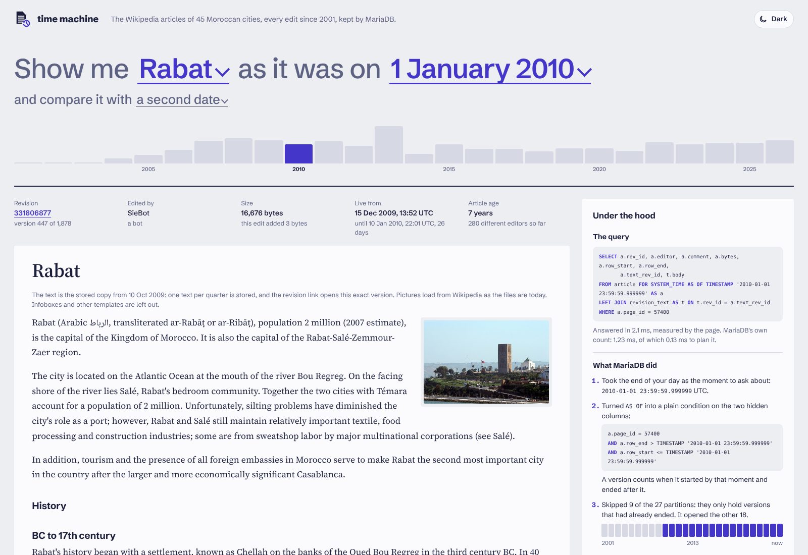
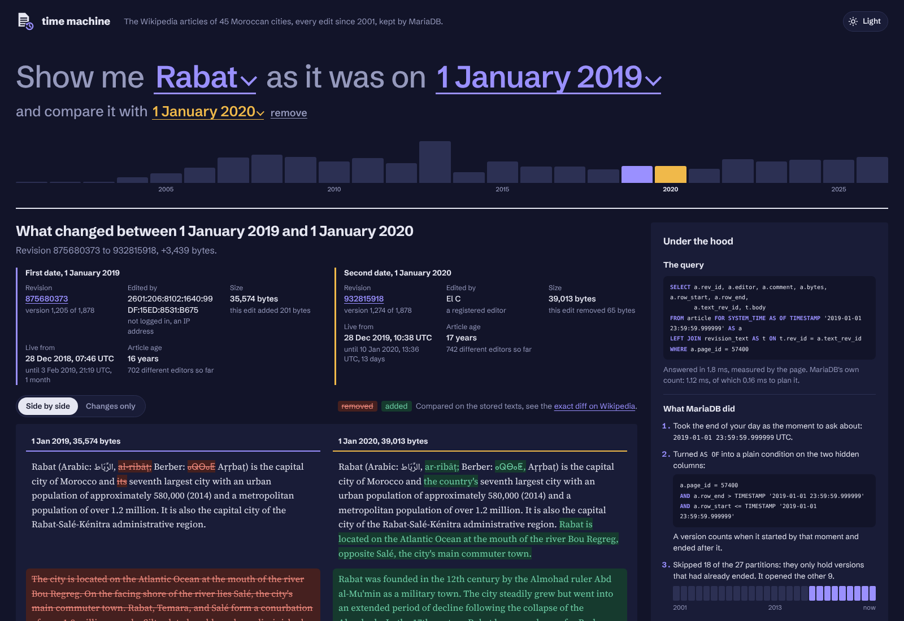
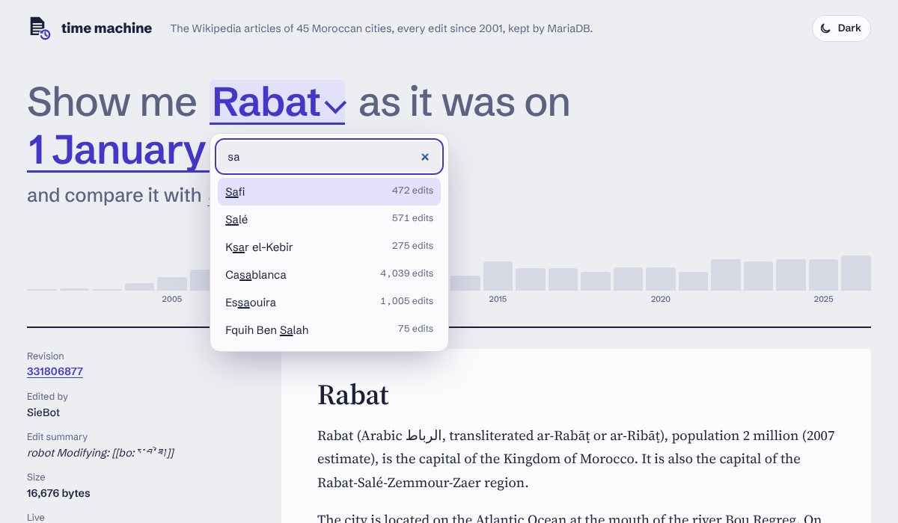

A project for area 3, "System-versioned tables: history for free" for the [MariaDB student database projects, 2026-09](https://mariadb.org/bachelor_hackathon_2026-09/).

<p align="center">
  <picture>
    <source media="(prefers-color-scheme: dark)" srcset="docs/logo/logo-dark.svg">
    
  </picture>
</p>

<h1 align="center">Wikipedia time machine on MariaDB</h1>

<p align="center">
  Pick a Moroccan city and a date, and read its Wikipedia article as it stood that day.<br>
  The history is kept by one table <code>WITH SYSTEM VERSIONING</code>: no revision table, no triggers, no application code.
</p>

<p align="center">
  
  
  
  
</p>

<p align="center">
  <a href="#quick-start">Quick start</a> ·
  <a href="#how-time-is-modelled">How time is modelled</a> ·
  <a href="#the-page">The page</a> ·
  <a href="#found-so-far">Found so far</a> ·
  <a href="#roadmap">Roadmap</a>
</p>



## In short

- **Real history, real dates.** 31,179 revisions of 45 Moroccan city articles, from November 2001 to October 2026, loaded with Wikipedia's own edit times as `row_start` and `row_end`.
- **One clause answers "what did it say then?"** `FOR SYSTEM_TIME AS OF` picks the version; the page shows it, compares two dates side by side, and explains how MariaDB found it.
- **Two clocks.** `article` keeps Wikipedia time as system time. `article_period` keeps it as application time that can be corrected, with system time on top: bitemporal.
- **Checked against the source.** 220 moments are worked out in Python from the raw API data and compared with what `AS OF` returns. All 15 database checks and 28 page tests pass.

> **Status (27 Oct 2026):** the data, schema, loader, queries, examples, tests and the page are done, ahead of the plan. Measurements come next. See the [roadmap](#roadmap).

## Why

Wikipedia runs on MariaDB and keeps its history in an application-level `revision` table, designed years before system versioning existed. This project loads the real edit history of 45 Moroccan city articles into a system-versioned table and answers "what did the article say on that date?" with one clause:

```sql
SELECT rev_id, editor, bytes
FROM article FOR SYSTEM_TIME AS OF TIMESTAMP '2005-01-01 00:00:00'
WHERE page_id = 57400;   -- Rabat
```

## Quick start

Requirements: Docker with Compose (tested with Colima on an Intel Mac) and Python 3.8 or newer. Then one command:

```sh
git clone https://github.com/ayoublabrinssi/Capstone-MariaDB-time-machine.git
cd Capstone-MariaDB-time-machine
scripts/start.sh
```

It checks the tools, makes `.env` with a random password, starts MariaDB 12.3.3, asks which data to use and downloads it from Wikipedia (about 15 minutes, the first time only), loads it, runs the 15 database checks and 28 page tests, and starts the page on http://127.0.0.1:8000. Run it again any time: the steps already done are skipped. `scripts/start.sh --help` lists the options.

### Which data

`start.sh` asks first, before anything else. `--data fixed` or `--data newest` answers without asking.

| | Fixed date (default) | Newest |
|---|---|---|
| Edits | up to 26 Oct 2026, the last revision of each article is in [data/snapshot.tsv](data/snapshot.tsv) | every edit up to the day you run it |
| Use it to | compare with the test results and the numbers in this README | see the articles as they are today |
| Same numbers as the test results, `results/` and this README | yes | no, results may differ from the test results |
| Tests | pass | pass |

The tests, the files in `results/` and every number in this README were made on the fixed date data. With the newest data, these change:

- more revisions and history rows, and a newer latest version of each article;
- `AS OF` an old date reads more rows, because more versions ended after it (Rabat on 1 January 2010: 1,432 rows on the fixed date data);
- the 2026 partition and any later ones hold more rows;
- the 220 test moments are drawn from the new data, so they are other moments;
- timings, once measured, will not match exactly.

The tests compare MariaDB with the downloaded data itself, so they pass with either. If Wikipedia has hidden a revision since 26 October 2026, the fixed date download says so and has one revision less.

### By hand

The same steps one by one:

```sh
cp .env.example .env          # set a root password
docker compose up --wait      # MariaDB 12.3.3, database timemachine
scripts/fetch.sh --snapshot data/snapshot.tsv   # fixed date, 26 Oct 2026 (about 15 min); without the option: newest
scripts/install.sh            # build the tables and load them (a few seconds)
scripts/test.sh               # 15 database checks and 28 page tests
scripts/run.sh                # the page, on http://127.0.0.1:8000
```

The page needs one package, PyMySQL, which goes into `.venv` on first start.

## The data

| | |
|---|---|
| Articles | 45 Moroccan cities, listed in [data/articles.txt](data/articles.txt) |
| Revisions | 31,179, from 11 Nov 2001 to 26 Oct 2026 |
| Stored text | 3,330 revisions: the first of every quarter and the latest of each article |
| Source | MediaWiki API, fetched 26 Oct 2026 by [fetch/fetch.py](fetch/fetch.py); the exact end of each article is in [data/snapshot.tsv](data/snapshot.tsv) |

The download is not committed (131 MB). `scripts/fetch.sh` repeats it and skips articles already on disk. [fetch/prepare.py](fetch/prepare.py) turns the JSON into tab-separated files for `LOAD DATA`.

Every revision is stored with its editor, comment and size. The full wikitext of every revision would be several GB, so the text is stored once per quarter. A version shows the closest stored text at or before it. The page will link to the exact revision on Wikipedia.

## How time is modelled

System versioning stamps a row with the moment the `INSERT` ran. A naive import would record the history of the loading script, not of the article. The area description gives three ways out:

| Option | What it means | Used here |
|---|---|---|
| Import-time stamps | replay the edits in order, accept that every row starts at load time | no: the dates would be meaningless |
| `system_versioning_insert_history` | write `row_start` and `row_end` yourself, once, with the real edit times | **yes**, table `article` |
| Application-time period | keep the edit times as ordinary columns with `PERIOD FOR` | **yes**, table `article_period`, next to system time |

**Why both.** Only system time gets `FOR SYSTEM_TIME AS OF`, partitioning by `SYSTEM_TIME` and `DELETE HISTORY`. So the time machine itself is `article`, with Wikipedia's own timestamps written in at import. But system time is append-only: once loaded, it can never be corrected. Real data needs corrections. `article_period` holds the same periods as ordinary data that can be updated with `FOR PORTION OF`, while its system time records when the database learned each fact. That makes it bitemporal: it answers "what was true then" and "what did we believe then".

[sql/examples/wikipedia_correction.sql](sql/examples/wikipedia_correction.sql) shows this on a real case: an edit to Marrakesh that was live for 19 hours in April 2018 before it was reverted.

```
| question                   | rev_id    |
| live on Wikipedia          | 838361314 |
| our service today          | 838361178 |
| our service before the fix | 838361314 |
```

## Data model

| Table | Kind | Rows | Holds |
|---|---|---|---|
| `page` | plain | 45 | one row per article |
| `revision_text` | plain, never changes | 3,330 | the stored wikitext |
| `article` | system-versioned, partitioned by year | 45 current, 31,179 in all | one version per revision, `row_start` / `row_end` = real edit times |
| `article_period` | bitemporal | 31,179 | `valid_from` / `valid_to` = edit times, `WITHOUT OVERLAPS` |

The text sits in its own table the way Wikipedia splits revisions from text. The schema is in [sql/01_schema.sql](sql/01_schema.sql), the load in [sql/02_load.sql](sql/02_load.sql).

`article` is partitioned by `SYSTEM_TIME` with one partition per year, 2001 to 2026, plus `pn` for current rows. A history row lives in the partition of the year its version **ended**.

## Query walk-through

[sql/queries.sql](sql/queries.sql) has ten commented queries, output in [results/queries.txt](results/queries.txt):

1. the current articles, read like any table
2. `AS OF`: Rabat on 1 January 2005
3. `AS OF` on all 45 articles at three dates (Fez grew from 3,795 to 197,500 bytes)
4. `BETWEEN`: every version of Casablanca live in the first week of March 2020
5. `ALL`: edits per year on Rabat
6. the shortest-lived versions (usually reverted vandalism)
7. the most active editors
8. one article at two dates
9. the partitions and what pruning does
10. the same question through the application-time period

## The page

`scripts/run.sh` starts a small page on http://127.0.0.1:8000. The question is one sentence: show me a city as it was on a date. The city list can be searched (accents are ignored, so "sale" finds Salé), and the date opens a calendar with its own month and year menus. The page shows the article as it stood at the end of that day, with a link to that exact revision on Wikipedia. Add a second date to compare: side by side, the old version on the left and the new one on the right, or as changes only. Removed text is red, added text is green, and a rewritten paragraph sits next to its new version. Pictures and simple tables are shown too: pictures sit on the right with the text wrapping around them, as on Wikipedia, and galleries are a grid, so the compare also tells when one was added or removed. A switch in the top corner changes between light and dark; without a choice the page follows the system.

Each article view is one query, shown under the article with its parameters filled in:

```sql
SELECT a.rev_id, a.editor, a.comment, a.bytes, a.row_start, a.row_end,
       a.text_rev_id, t.body
FROM article FOR SYSTEM_TIME AS OF TIMESTAMP '2010-01-01 23:59:59.999999' AS a
LEFT JOIN revision_text AS t ON t.rev_id = a.text_rev_id
WHERE a.page_id = 57400
```

The bars above the article are edits per year from `FOR SYSTEM_TIME ALL`; a click on a year jumps to 1 July of that year. A row above the article gives the facts about the version on show: revision and its number among all versions, the editor (person, IP address or bot), the size and what this edit changed, when it went live and for how long, the age of the article and how many people had edited it by then. When two dates are compared, each gets its own row.

Next to the article, an "Under the hood" panel shows how MariaDB answered:

| Part | What it shows | Where it comes from |
|---|---|---|
| The query | the `AS OF` query with its parameters, the time the page measured, and MariaDB's own time | the page, `ANALYZE` |
| What MariaDB did | the answer step by step: the moment asked about, `AS OF` rewritten as a condition on `row_start` and `row_end`, the partitions skipped and read, the rows and disk pages read through the key, the one row kept, the text fetched | `ANALYZE FORMAT=JSON` |
| Query plan | rows guessed before running next to rows read after | `EXPLAIN PARTITIONS`, `ANALYZE` |
| This row in system time | the invisible `row_start` and `row_end`, to the microsecond | the same query |
| Before and after | the previous and next versions, with links, and the number of edits that day | `FOR SYSTEM_TIME ALL` and `BETWEEN` |
| Cross-check | the revision the bitemporal table `article_period` gives for the same moment | application time |
| What is stored | rows and size of each table, current and history rows, the server version | `information_schema` |

The step-by-step view makes one thing plain: for 1 January 2010 MariaDB reads 1,432 of Rabat's rows to keep one, because the key starts at `row_end` and every version that ended after that date is a candidate. For 1 October 2026 it reads 13 rows, and for 1 January 2005 it reads 1,857. More on this in "Found so far".





The code is [app/server.py](app/server.py) (Python standard library `http.server` plus PyMySQL), [app/wikitext.py](app/wikitext.py), and [app/app.js](app/app.js) for the city list and the calendar, in plain JavaScript with no framework. Without JavaScript the page falls back to the browser's own select and date inputs. The fonts come from Google Fonts; offline, the page uses system fonts. Limits, said plainly:

- **The text is a quarterly sample.** The revision, editor, size and dates are exact. The text is the stored copy at or before that revision, and the page says which one. When two dates fall back to the same stored copy, the page says so and links to Wikipedia's own diff instead of showing an empty one.
- **The wikitext cleaner is not a MediaWiki parser.** It keeps the names in other languages (`{{lang-ar|...}}` becomes "Arabic: ...") and converted numbers, drops other templates and references, and keeps links as plain words. Infoboxes, climate boxes and some inline values (like a name in Arabic inside a template) are lost; only the infobox photo is kept. Tables keep their rows and cells, without row or column spans.
- **Pictures are today's files.** The database stores the file name only, and the page loads the picture from Wikipedia, so a file that was changed since shows its new version, and a deleted one is hidden. This needs an internet connection.
- **It is read-only and local.** It listens on 127.0.0.1 only, and every connection is set to `READ ONLY` and `time_zone = '+00:00'`, the time zone the edit times were loaded in.

## Same idea in a fleet app

[sql/examples/fleet.sql](sql/examples/fleet.sql) applies the same model to vehicle tracking. It is based on JPTrack, a fleet tracking platform in Morocco, with invented data. A driver assignment is corrected after the fact with `UPDATE ... FOR PORTION OF`, the table answers "who drove TRK-12 on 12 March" today and before the correction, and `WITHOUT OVERLAPS` refuses a second driver on the same truck. Output in [results/fleet.txt](results/fleet.txt).

## Tests

`scripts/test.sh` runs two sets.

[tests/tests.sql](tests/tests.sql) has 15 database checks. The main one: [fetch/prepare.py](fetch/prepare.py) picks 220 moments and computes in Python, from the raw JSON, which revision was live at each. The test runs every moment through `FOR SYSTEM_TIME AS OF` with parameters and expects the same revision. It also checks the application-time table agrees, and that the server refuses what it should. Output in [results/tests.txt](results/tests.txt).

[tests/test_app.py](tests/test_app.py) has 28 tests for the page: the wikitext cleaner (with pictures, tables and names in Arabic and Berber), the diff and the side-by-side view, the date input (including an injection attempt), and the page against the database, including that the period table agrees. The database ones are skipped, not failed, when MariaDB is not running.

## Found so far

Things the documentation does not make obvious, all tested on 12.3.3:

- **Importing history needs a session switch.** Without `system_versioning_insert_history = 1`, writing `row_start` fails with error 1906.
- **`PARTITION BY SYSTEM_TIME ... AUTO` puts imported history into one partition.** It only creates partitions as the server clock moves. Pre-creating them with `STARTS '2001-01-01' PARTITIONS 27` spreads 31,134 history rows over 26 yearly partitions, and `AUTO` keeps adding new ones.
- **Pruning helps recent questions only.** `AS OF '2026-06-01'` reads 2 partitions. `AS OF '2005-06-01'` reads 23 of 27, because a version that ended in 2020 may have started before 2005. Partitions are cut by end time, not by start time.
- **`ALTER TABLE` on a versioned table is refused** (error 4119) unless `system_versioning_alter_history` is changed. Settle the schema before loading.
- **The `WITHOUT OVERLAPS` error is hard to read.** It says `Duplicate entry 'TRK-12-2026-03-25-2026-03-20'`: the period end comes before the start.

These will be reported to MariaDB in step 7 of the [roadmap](#roadmap).

## Where it loses

Said plainly, from what this project ran into:

- **System time cannot be corrected.** Once a row is in history it stays as it is. A wrong edit time needs the application-time table next to it, which is why `article_period` exists.
- **Old dates cost more.** The key starts at `row_end`, so `AS OF` 2005 reads 1,857 of Rabat's rows to keep one, while `AS OF` October 2026 reads 13. Partitions help recent questions, not old ones.
- **Importing history is a special case.** It needs `system_versioning_insert_history`, and `AUTO` partitioning puts all imported history into one partition unless the partitions are created first.
- **The schema is hard to change later.** `ALTER TABLE` is refused on a versioned table by default.
- **History only grows.** Nothing is removed until someone runs `DELETE HISTORY` or drops a partition. Week 4 measures how fast it grows.

## Roadmap

The plan runs six weeks, from 26 October to the final presentation on 3 December 2026. Each step is a [GitHub issue](https://github.com/ayoublabrinssi/Capstone-MariaDB-time-machine/issues).

| Step | What | Issue | State |
|---|---|---|---|
| 1 | Fetch the revision history of 45 articles | [#1](https://github.com/ayoublabrinssi/Capstone-MariaDB-time-machine/issues/1) | done |
| 2 | Schema with two clocks: system time and application time | [#2](https://github.com/ayoublabrinssi/Capstone-MariaDB-time-machine/issues/2) | done |
| 3 | Load the revisions with their real dates, queries, tests | [#3](https://github.com/ayoublabrinssi/Capstone-MariaDB-time-machine/issues/3) | done |
| 4 | The page: pick a city and a date, compare two dates | [#4](https://github.com/ayoublabrinssi/Capstone-MariaDB-time-machine/issues/4) | done |
| 5 | Fleet example: who drove which truck, as we knew it then | [#6](https://github.com/ayoublabrinssi/Capstone-MariaDB-time-machine/issues/6) | done |
| 6 | Measure how the table grows and what partitioning does | [#5](https://github.com/ayoublabrinssi/Capstone-MariaDB-time-machine/issues/5) | next |
| 7 | README, limits reported to MariaDB, evaluation run | [#7](https://github.com/ayoublabrinssi/Capstone-MariaDB-time-machine/issues/7) | planned |

What the measurements in step 6 will answer:

- How big are the table and its index at 1x, 2x and 4x the data?
- How long does `AS OF` take with and without partitions (3 runs each, median and spread)?
- What shrinks after `DELETE HISTORY` or after dropping a partition?
- How does the same question compare on a classic revision table with a join, the way Wikipedia stores it today?

The results will go in `docs/measurements.md`, with the setup: Intel Mac 2017, Colima 2 CPU / 4 GB, MariaDB 12.3.3. Step 7 adds a "What it replaces" section, reports the limits above to MariaDB, and runs the MariaDB evaluation prompt on the finished repository. The target is to finish by 27 November and keep the last week as a buffer.

## Project structure

```
compose.yaml          MariaDB 12.3.3 in Docker, password from .env
scripts/              start.sh (all in one), fetch.sh, install.sh, test.sh, run.sh, db.sh
fetch/                fetch.py (Wikipedia API), prepare.py (JSON to TSV)
sql/                  01_schema.sql, 02_load.sql, queries.sql, examples/
tests/                tests.sql (database), test_app.py (page)
results/              output of the queries, examples and tests
data/                 articles.txt; raw/ and load/ are not committed
app/                  the time machine page: server.py, wikitext.py, app.js, style.css, logo.svg
docs/                 AI-log.md, SELF-ASSESSMENT.md, screenshots/, logo/ (light, dark, black, white, png)
```

## Team

Ayoub Labrinssi, Constructor University Bremen, MSc Computer Science and Software Engineering. Supervisor: Dr. Joaquin Aguado. Partner: MariaDB Foundation.

AI use is recorded in [docs/AI-log.md](docs/AI-log.md).

## License

Code under MIT, see [LICENSE](LICENSE). Wikipedia text is CC BY-SA 4.0 and belongs to its authors.
