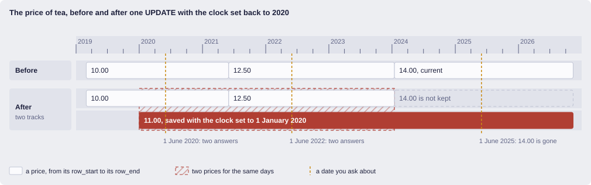

# 2. Setting the clock back loses a version

**In one sentence.** If a session sets its clock to a moment before the current version started and then runs an `UPDATE`, MariaDB accepts it, silently drops the current version, and the new version overlaps older ones, so some dates return two answers.

[← All findings](README.md)

## The idea

A versioned table is like a price notebook. Each line says "this price, from this date, until this date". For any day you pick, exactly one line should be true.

The server writes these dates itself, using its clock. But MariaDB lets a session move its own clock with `SET @@timestamp`. That is useful: you can replay old changes in order and let the server write the history. Going forward works. Going back breaks the notebook.

## See it happen

The example is step 8 of [sql/examples/limits.sql](../../sql/examples/limits.sql): the price of tea, changed three times, each time with the clock set to the day of the change.

```sql
SET @@timestamp = UNIX_TIMESTAMP('2019-03-01'); INSERT INTO limit_clock VALUES ('tea', 10.00);
SET @@timestamp = UNIX_TIMESTAMP('2021-06-01'); UPDATE limit_clock SET mad = 12.50;
SET @@timestamp = UNIX_TIMESTAMP('2024-01-15'); UPDATE limit_clock SET mad = 14.00;
```

Each `UPDATE` does two things: it closes the current line at the clock's time, and opens a new line from that time. The notebook is clean. The lines touch end to end, so every day has one price.

| Price | From | Until |
|---|---|---|
| 10.00 | 1 March 2019 | 1 June 2021 |
| 12.50 | 1 June 2021 | 15 January 2024 |
| 14.00 | 15 January 2024 | still current |

**Now one step back.** Someone sets the clock to 1 January 2020 and changes the price to 11.00.

```sql
SET @@timestamp = UNIX_TIMESTAMP('2020-01-01');
UPDATE limit_clock SET mad = 11.00;      -- the server answers: accepted
```

The server has to close the current line, 14.00, "until 1 January 2020". But that line started in 2024. It would end before it starts, which is impossible, so the server does not keep it at all. Then it opens 11.00 from 1 January 2020. No error, no warning.

| Price | From | Until |
|---|---|---|
| 10.00 | 1 March 2019 | 1 June 2021 |
| 11.00 | 1 January 2020 | still current |
| 12.50 | 1 June 2021 | 15 January 2024 |
| ~~14.00~~ | | not kept |

On a timeline, before and after:

<p align="center">
<picture>
  <source media="(prefers-color-scheme: dark)" srcset="../../design/charts/clock-back-dark.svg">
  
</picture>
</p>

Read it like the timeline of a video editor: each clip is one line of the notebook. After the update, 11.00 needs a second track, because from January 2020 to January 2024 it covers the same days as 10.00 and 12.50 (the red stripes). That is what "overlap" means here: two lines for the same days. The dotted lines are the three dates of the table below.

**Ask the notebook a date:**

| Date | Before | After |
|---|---|---|
| 1 June 2020 | 10.00 | **10.00 and 11.00**, two rows for one item |
| 1 June 2022 | 12.50 | **12.50 and 11.00** |
| 1 June 2025 | 14.00 | **11.00**, and 14.00 is gone from the history |

## How we found it

There are two ways to load a past into a versioned table: write the dates directly with `system_versioning_insert_history`, or replay the changes in order with `SET @@timestamp`. The project uses the first. To write the import tutorial I tested the second one too, and tried what happens when the replay is out of order.

## Why it matters

- **A real price is deleted.** 14.00 was the price from January 2024 on. No line remembers it.
- **Some days have two answers.** Anything that expects one row per item breaks: a join doubles, a total counts twice.
- **Nobody is told.** No error, no warning. An invoice, a report or an audit built on this history is wrong, and nothing shows it.

A replay can go out of order for ordinary reasons: two sources merged, a batch run twice, a time zone mixed up.

## What works

- **Do not replay with the clock.** This project writes the real dates directly (`system_versioning_insert_history`), so the order of the statements does not matter. See the [import tutorial](../import-tutorial.md).
- **If you must replay,** sort by time first and check afterwards that no two versions of a key overlap. Step 5 of the tutorial has the check query.
- **On a real server,** load the history first, then start the server with `secure_timestamp=YES`. After that no session can move its clock (error 1290), for root too. See [finding 5](05-anyone-can-write-the-past.md).

## What we suggest to MariaDB

Refuse an `UPDATE` or `DELETE` whose time is not after the start of the row it closes. The server already refuses an imported row that ends before it starts (error 4112). This is the same mistake, made by the server itself. At least, a sentence in the documentation next to the `SET @@timestamp` example.

## Try it yourself

<details>
<summary>Run it</summary>

```sh
scripts/db.sh -t < sql/examples/limits.sql
```

Step 8 prints the history before and after, the server's "accepted", and `rows_as_of_mid_2020 = 2`. The full output is in [results/limits.txt](../../results/limits.txt).
</details>
