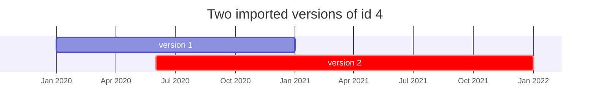

# 6. Imported versions can overlap

**In one sentence.** When you import history, MariaDB checks that each version ends after it starts, but not that two versions of the same key cover different months, so `AS OF` a moment in between returns two rows for one key.

[← All findings](README.md)

## The idea

Back to the price notebook from [finding 2](02-clock-set-back-loses-a-version.md): each line says "this value, from this date, until this date", and any day should have exactly one true line.

When the server writes the history itself, that is always true: each new line starts exactly where the old one ends. When you import history, you write the dates yourself. The server checks each line on its own. It does not compare it with the other lines of the same key.

## See it happen

From step 2 of [sql/examples/limits.sql](../../sql/examples/limits.sql), with `system_versioning_insert_history = 1`:

| Tried | The server says |
|---|---|
| a version that ends before it starts | error 4112, refused |
| two versions of id 4: January 2020 to January 2021, and June 2020 to January 2022 | **accepted** |



`AS OF '2020-09-01'` then returns both rows, for one primary key:

```
+----+------+---------------------+---------------------+
| id | v    | row_start           | row_end             |
+----+------+---------------------+---------------------+
|  4 |    1 | 2020-01-01 00:00:00 | 2021-01-01 00:00:00 |
|  4 |    2 | 2020-06-01 00:00:00 | 2022-01-01 00:00:00 |
+----+------+---------------------+---------------------+
```

For comparison: the same two rows in an application-time table with `WITHOUT OVERLAPS` are refused (error 1062). Application time has an overlap check. System time has none.

## How we found it

The project's loader computes `row_end` of each revision as the `row_start` of the next one. A mistake there would produce exactly this. Step 2 of `limits.sql` asks the server whether it would notice. It does not, so the project checks it itself.

## Why it matters

Anything that expects one row per key at a moment breaks without an error: joins return duplicates, totals count twice. The shortcut of [finding 3](03-old-dates-read-the-whole-history.md) would silently pick one of the two.

## What works

Check the imported history yourself, once, right after the load. Check 21 in [tests/tests.sql](../../tests/tests.sql) does it for every article: the versions of each article must form one unbroken line, with no overlap and no gap. Step 5 of the [import tutorial](../import-tutorial.md) has the same check as a query you can copy.

## What we suggest to MariaDB

A sentence in the documentation next to `system_versioning_insert_history`: imported versions are not checked against each other, with a check query to run after the load. A further step would be an optional check on import, like `WITHOUT OVERLAPS` does for application time.

## Try it yourself

<details>
<summary>Run it</summary>

```sh
scripts/db.sh -t < sql/examples/limits.sql
```

Step 2 is near the top. The full output is in [results/limits.txt](../../results/limits.txt).
</details>
